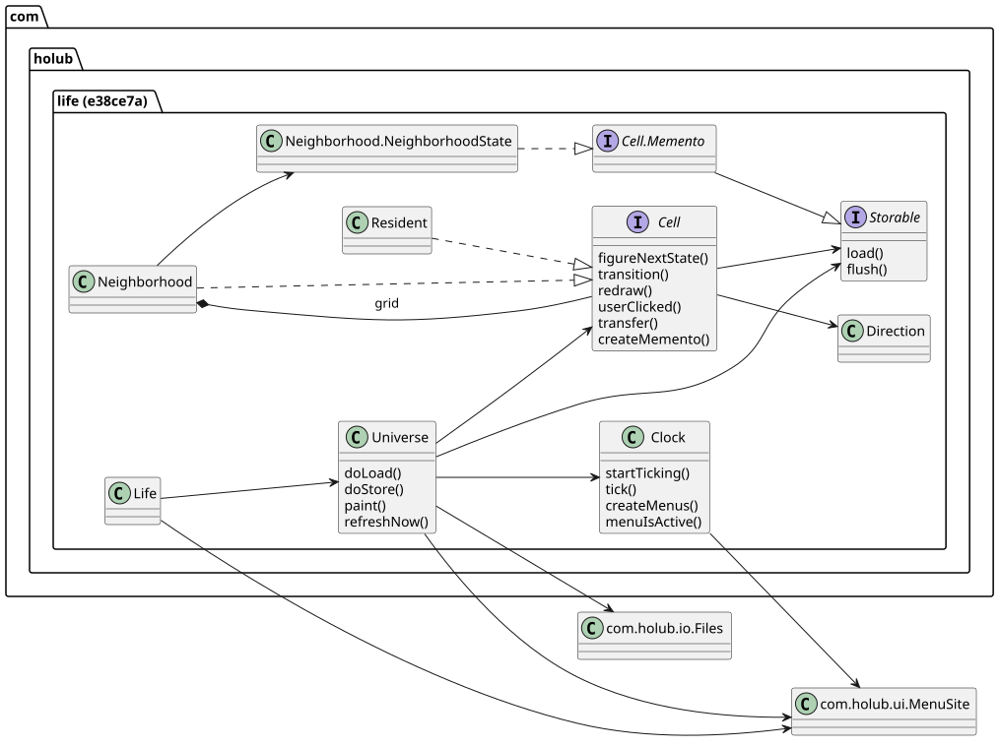
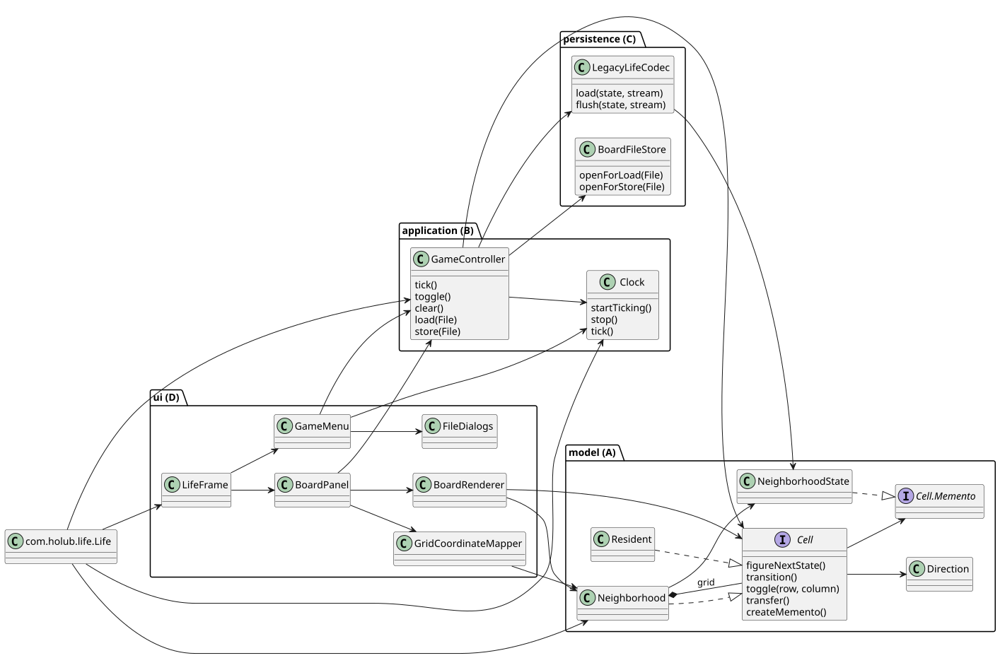

# [002] 동작을 유지한 도메인별 메서드 추출

- 상태: 채택
- 작성: Codex / 2026-11-03 / 관련 이슈: [#24](https://github.com/DesignPattern8/DPTermProject/issues/24)
- 비교 기준: e38ce7a (원본). 구현 순서: 특성 테스트 → 저장 인코딩 → 모델/그리기 → 실행/메뉴/조립.

## 문제
원본 Universe.java:37~143은 패널·입력·메뉴·tick을, :153~188은 파일 선택·스트림·보드 변경·오류 표시를 함께 수행했다. Neighborhood.java:286/345/409는 그리기·픽셀 변환·직렬화를 포함했다. Clock.java:81/171의 메뉴 책임 때문에 headless에서 제어 흐름을 만들 수 없었다.

## 후보
| 후보 | 구조 | 판단 |
| --- | --- | --- |
| A. 패키지만 이동 | 기존 9개 최상위 파일을 도메인별로 배치 | 책임 혼합과 Swing 의존이 남아 기각 |
| B. 기존 메서드 추출 | 구체 클래스에 기존 본문을 옮기고 호출부·패키지를 함께 전환 | 채택 |
| C. 새 GoF 추상화 | Board Facade, 규칙 Strategy, Codec Adapter/Strategy, 렌더링 Visitor/Decorator, 편집 Command, 실행 State | 이번 요청의 새 패턴 미도입 범위를 벗어나 제외 |

기존 Composite/Memento/Clock의 Publisher 알림은 유지한다. 새 Board/CompositeBoard/LifeRule/SnapshotCodec/TickSource/GameListener 인터페이스를 만들지 않았다. 새로운 알고리즘·기능·오류 검증도 추가하지 않았다.

## 파일·메서드 이전표
| 원본 | 현재 | 추출 내용 |
| --- | --- | --- |
| Cell, Resident, Neighborhood, Direction | model/동명 파일 | 기존 계산·생사 조건·전이·활성 경계 유지 |
| Neighborhood.NeighborhoodState | model/NeighborhoodState | 기존 가변 Memento 데이터·markAsAlive/isAlive/toString |
| NeighborhoodState.load/flush | persistence/LegacyLifeCodec | 기존 ObjectInputStream/ObjectOutputStream 본문 |
| Storable | 제거 | IO 계약을 모델에서 제거. 구체 Codec 함수로 호출 전환 |
| Universe의 파일 스트림 생성 | persistence/BoardFileStore | openForLoad/openForStore |
| Universe의 tick, Clear, 편집, doLoad/doStore 순서 | application/GameController | 실제 모델 호출과 기존 작업 순서 |
| Clock | application/Clock | Singleton, Timer, TimerTask, Publisher, Listener 유지 |
| Clock.createMenus/menuIsActive 및 Universe 메뉴 | ui/GameMenu | 동일 항목·속도·이벤트·메뉴 열림 필터 |
| Universe의 패널·paint/refreshNow | ui/BoardPanel | 크기·마우스·전체/부분 갱신 |
| Resident/Neighborhood.redraw | ui/BoardRenderer | 동일 색·재귀 순서·블록 테두리 |
| Neighborhood.userClicked의 픽셀 계산 | ui/GridCoordinateMapper | 기존 재귀 정수 나눗셈. 실제 변경은 Cell.toggle |
| io/Files | ui/FileDialogs | JFileChooser·필터·취소 예외 유지 |
| Life의 JFrame 구성 | ui/LifeFrame | 제목·메뉴 연결·종료·레이아웃 |
| Life.main | life/Life | 기존 8×8×8×8 보드 생성과 도메인 연결 |

`src`/`test` 소스 루트는 유지한다. 기존 보조 MenuSite/Colors/Publisher/ConditionVariable/Log는 변경하지 않는다. rule/pattern/command 패키지는 구현할 기능이 없어 만들지 않는다.

## 의존 경계와 남긴 타입
- model → ConditionVariable, java.awt.Point, java.util. Graphics/Rectangle/Swing/파일 IO 의존 없음.
- application → model/persistence/Publisher, 기존 Timer·Point·IO. Swing 의존 없음.
- persistence → 모델 Memento 데이터·IO. Cell을 직접 변경하지 않음.
- ui → application과 모델의 읽기/좌표 정보. 제품의 편집 요청은 GameController를 거침.
- Life → 각 구현 생성·연결.

불변 스냅샷이나 읽기 전용 트리 인터페이스를 새로 설계하지 않았다. Neighborhood.childAt은 UI의 읽기와 원본 좌표 계산에 사용한다. beginRedraw는 원본 갱신 플래그/읽기 대기를 캡슐화한다. Point와 가변 Memento를 유지한 것은 기존 좌표·잘못된 파일·중복 기록 동작을 보존하기 위한 범위 선택이다.

## 오버헤드 실측
2026-11-03 작업 트리와 e38ce7a를 비교했다. 대상은 원본 life/*.java 8개 + io/Files.java 1개, 변경 후 life 아래 Java 16개다. 물리적 행 수(빈 줄·주석 포함)를 세었으며 성능 지표가 아니다.

| 항목 | 전 | 후 / 변화 |
| --- | --- | --- |
| 최상위 Java 파일/타입 | 9 | 16 (+7) |
| 그중 최상위 클래스 | 7 | 15 (+8; 내부 NeighborhoodState의 최상위 이동 포함) |
| 최상위 인터페이스 | Cell, Storable: 2 | Cell: 1 (-1) |
| 중첩 계약 | Cell.Memento, Clock.Listener | 둘 다 유지 |
| 대상 소스 LOC | 1,393 | 1,314 (-79) |
| 모델 import 패키지 수 | 7 | 3 (-4) |
| 사용자 클릭 경로 | 픽셀 해석·변경을 한 경로에서 처리 | 좌표 해석 d단계 + 변경 d단계 |
| 파일 열기 호출 | Universe에서 직접 생성 | Controller → BoardFileStore의 구체 함수 1단계 추가 |
| 시간/할당 비용 | 미측정 | 미측정. 개선 주장 없음 |
| 테스트 | UI 결합으로 제어 객체 생성 제한 | JFrame 없이 Controller/Clock/Codec 검증 가능 |
| 기존 도메인 수정 범위 | 화면·파일·계산이 같은 파일 | 파일 인코딩은 LegacyLifeCodec, 그리기는 BoardRenderer 중심으로 수정 가능 |

유효 기능의 수는 증가하지 않았다. 소스 수 증가는 기존 메서드 분리에 따른 것이다. 메서드 호출 수 외의 런타임 오버헤드는 측정하지 않았다. 새 파일 형식을 도입할 경우 실제 수정 범위는 별도 설계가 필요하다.

## 전/후 UML
루트 diagrams/ 원본은 변경하지 않았다. 아래는 실제 추출 대상만 표시하며 보조 라이브러리 전체의 내부 구현은 생략했다.

| 이전 (e38ce7a) | 이후 |
| --- | --- |
|  |  |

원본: [before.puml](diagrams/before.puml), [after.puml](diagrams/after.puml). PlantUML 1.2025.2로 SVG를 생성했다.

## 검증·후속 작업
[검증 결과](verification.md) 및 [테스트 정의](../../docs/domain-extraction-tests.md).

#10 중복 저장, #11 ClassCastException, #12 transition 반환값을 유지했다. 읽기 실패 후 빈 보드, 취소 시 오류 표시, 실패 경로의 스트림 정리 방식도 원본과 같다. 버그 수정, Undo/Redo, 프리셋, 규칙 교체, 타이머 스레드 교체는 이번 PR 범위 밖이다.
