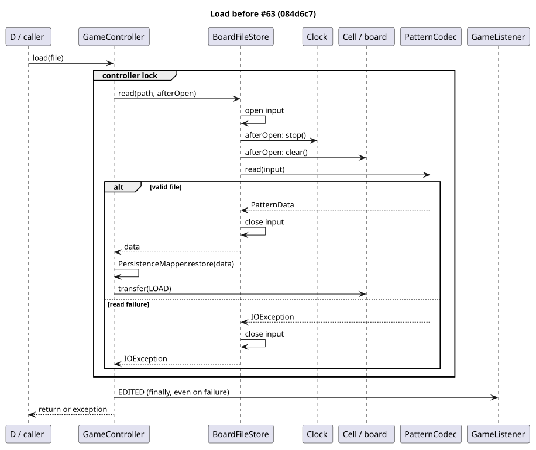
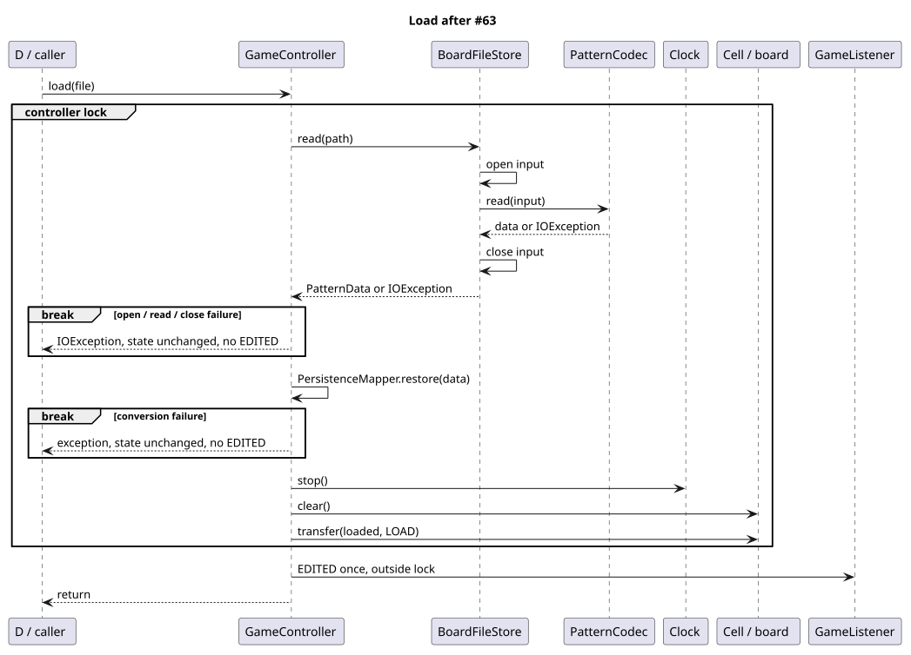

# [005] Load 해석 성공 후 보드 교체

- 상태: 채택
- 작성자 / 날짜: Codex / 2026-11-17 / 관련 이슈: #63
- 기준: refactor/base `084d6c7`. #64·#65 PR은 아직 포함하지 않는다.

## 문제

기준 `GameController.java:123`의 load는 C의 afterOpen 콜백에서 Clock을 정지하고 기존 셀을 지운다. 따라서 파일은 열렸지만 해석이 실패하면 기존 일반·암세포가 사라진다. finally의 EDITED도 실패를 보드 변경으로 알린다. `BoardFileStore.read`는 반환하기 전에 파일을 닫으며, `PersistenceMapper.restore`는 보드를 건드리지 않고 새 Memento를 구성한다.

## 후보

### A. 기존 Facade에서 읽기·변환 완료 후 적용 — 채택

같은 controller 잠금 안에서 read(Path)와 Mapper 변환을 먼저 끝낸다. 그다음 stop → clear → transfer(LOAD)를 수행하고 잠금 밖에서 EDITED를 한 번 알린다. 파일/해석 오류에는 복구 작업 자체가 필요 없다.

### B. Memento 백업 후 실패 시 rollback

기존 보드 캡처와 실패 복원 순회가 추가된다. 현재 createMemento는 Neighborhood.transfer(STORE)를 통해 활성 정보를 건드릴 수 있고, Clock에는 실행 상태/주기 조회 API가 없어 재시작 계약도 추가해야 한다. 읽기 오류를 처리하기 위해 이를 늘릴 이유가 없다.

### C. Command로 준비·적용·취소 분리

별도 명령 타입과 조립 경로가 필요하다. Undo/Redo 또는 비동기 파일 요청이 없는 이번 수정에는 불필요하다.

## 결정과 근거

A를 채택한다. 읽기와 값 변환은 모델 비변경 작업이므로 완료 후 변경을 시작하는 것만으로 파일 오류에 대한 보존을 달성한다. 암세포가 없는 BoardSnapshot 대신 기존 NeighborhoodState/transfer 경로를 유지한다. C의 afterOpen API는 다른 호출자와 기존 계약 테스트를 위해 유지하고, GameController만 부작용 없는 read(Path)를 사용한다.

## 행동 계약

| 결과 | 보드·암세포 | Clock | 알림 |
| --- | --- | --- | --- |
| 개방/해석/읽기 종료 실패 | 변경 없음 | 기존 실행 여부·속도·예약 유지 | 없음, IOException 그대로 전달 |
| 읽기 후 Memento 변환 실패 | 변경 없음 | 변경 없음 | 없음, 원래 런타임 예외 전달 |
| 성공 | 이전 셀을 지우고 새 일반·암세포 배치 | 정지 | 잠금 밖 EDITED 1회 |

정상 빈 목록은 보드를 비우는 성공이다. 0바이트 파일은 읽기 실패다. 기존 중복·범위 밖 좌표 해석을 유지한다. 암세포 게임의 치료 횟수/진행 단계 초기화는 기존 Load에도 없으며 추가하지 않는다. D의 IOException 오류 표시 계약은 그대로다.

load 전체의 기존 잠금은 유지한다. 읽는 동안 tick/편집은 대기하고 실패 후 잠금이 풀리면 계속 진행할 수 있다. 보존은 Load가 상태를 바꾸지 않는다는 뜻이지 실행 중인 시계를 영구적으로 멈춘다는 뜻이 아니다. 이미 시작된 Timer callback 취소나 외부 Clock 호출의 동기화 개선은 범위 밖이다.

검증된 파일을 적용하는 Cell.clear/transfer 또는 Clock/리스너의 프로그램 오류까지 rollback하는 트랜잭션을 보장하지 않는다. 리스너 예외는 이미 적용된 보드를 되돌리지 않는다.

## 오버헤드 비교표

| 항목 | A 읽기 후 적용 | B Memento rollback | C Command |
| --- | --- | --- | --- |
| 구조 비용 | 생산 GameController 1파일, +8/-15 LOC(순 -7), 타입 추가/삭제 0 | 미구현 추정: Clock 상태 API와 복구 경로, 최소 2파일; LOC 미측정 | 미구현 추정: 명령 타입 +1 이상, 최소 2파일; LOC 미측정 |
| 간접성 | 새 위임 단계 0; 기존 read(Path) overload 사용 | 실패 시 복원 호출 추가 | 명령 execute 위임 +1 |
| 결합도 | 직접 타입 PatternData → NeighborhoodState 교체, 의존 패키지 증감 0, Swing 추가 0 | Clock 상태 조회·복구 계약 추가 | Controller와 명령 타입 결합 추가 |
| 런타임 | 기존 읽기·변환 1회, 성공 보드 clear/transfer 각 1회; 실패 보드 순회 0 | 캡처 1회 추가, 실패 복원 1회 추가 | 명령 객체 및 실행 호출 추가 |
| 테스트 | 수동 TickSource·실제 파일·Codec 대역, Swing 없음 | rollback 자체의 실패까지 검증 필요 | 명령과 조립 모두 검증 필요 |
| 확장 비용 | 입력 정책 추가는 Codec에 위임, Load 정책은 1곳 | 새 상태마다 백업·복원 추가 | 새 요청마다 명령 구현 추가 |

호출/순회 횟수는 소스 경로 기준이다. 시간·힙 성능 벤치마크 수치를 주장하지 않는다.

## 전/후 비교

```java
// 이전: 해석 전에 모델과 Clock을 변경
PatternData data = files.read(path, () -> { clock.stop(); fileCells.clear(); });
fileCells.transfer(PersistenceMapper.restore(data), new Point(0, 0), Cell.LOAD);
// finally에서 EDITED

// 이후: 동일한 잠금 안에서 읽기·닫기·변환을 먼저 완료
NeighborhoodState loaded = PersistenceMapper.restore(files.read(path));
clock.stop();
fileCells.clear();
fileCells.transfer(loaded, new Point(0, 0), Cell.LOAD);
// 성공 시에만 잠금 밖에서 EDITED
```

[이전 원본](diagrams/005-before.puml) / [이후 원본](diagrams/005-after.puml)

| 이전 | 이후 |
| --- | --- |
|  |  |

생산 LOC는 기준 커밋 대비 `git diff --numstat` 실측(공백 포함)이다. [검증 기록](verification-063.md)에 RED/GREEN과 기존 기대값 변경을 남겼다.

## 후속 작업

#64·#65 병합 후 안전한 Store와 제한 Codec을 조합한 통합 회귀를 확인한다. #71 모델 좌표 API·#73 암세포 Snapshot 계약 변경은 별도 모델 협의 대상이다. 본 수정은 현재 Memento 저장 형식을 유지한다.

정상 Load 후 블록 경계 첫 세대 출생 누락은 기준 코드에서도 재현하여 [#81](https://github.com/DesignPattern8/DPTermProject/issues/81)로 분리했다. 실패 Load의 상태 보존과 별개이며 이번 코드에서 함께 수정하지 않는다.
