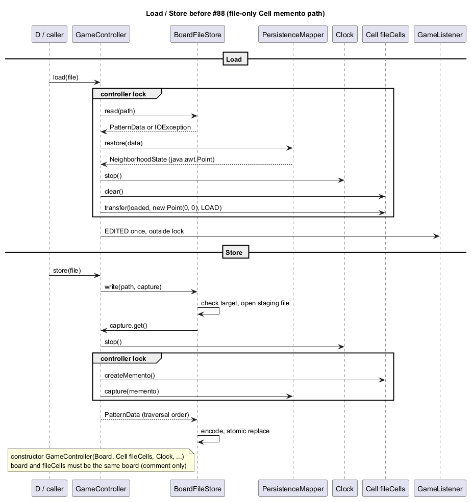
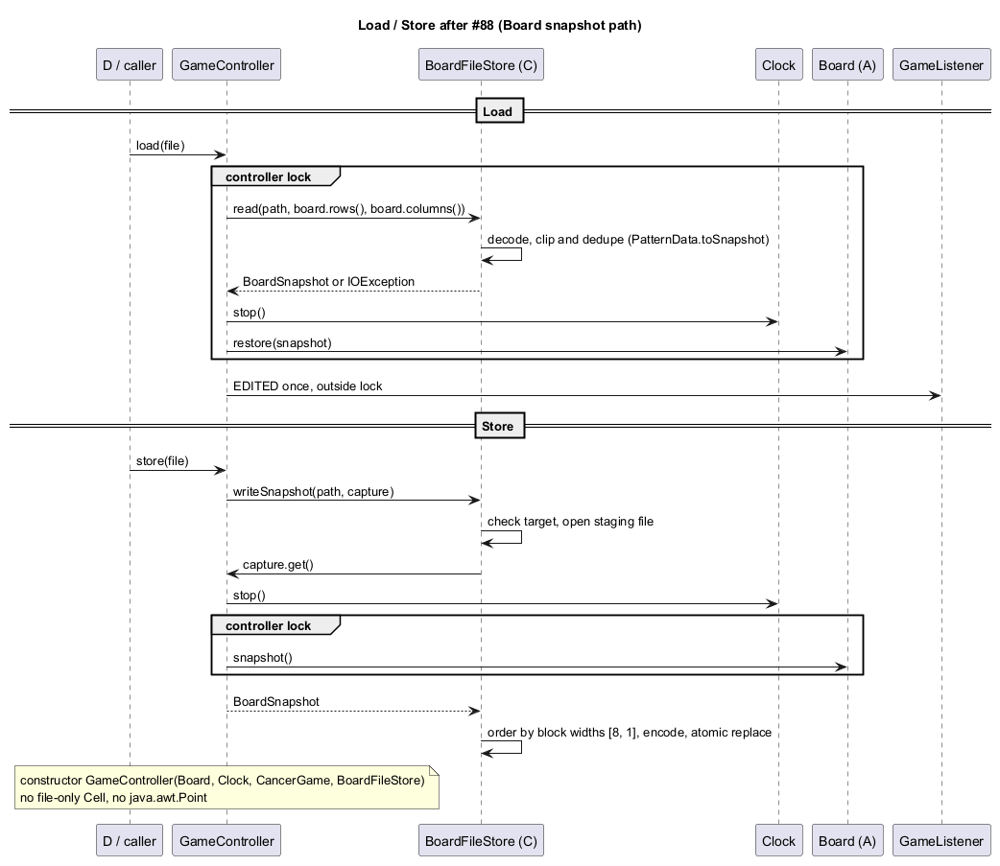

# 007 저장·불러오기를 Board 스냅샷 경로로 연결

- 상태: 채택
- 작성자: 이시형 / 2026-11-23
- 관련: 이슈 #88, #71(B 쪽), #81, C 이슈 #92·PR #93, 테스트 [SNAP-01~09](test-cases.md)

## 문제

004(D7-B)에서 편집·세대 진행은 A의 `Board`로 옮겼지만, Load·Store는 파일용 `Cell`의 Memento 경로를 그대로 썼다. 변경 전 코드(`8980376`, `GameController.java`):

```java
// :39  생성자가 같은 보드를 두 번 받는다
public GameController(Board board, Cell fileCells, Clock clock, CancerGame cancerGame) { ... }

// :123-131 Load
NeighborhoodState loaded = PersistenceMapper.restore(files.read(file.toPath()));
clock.stop();
fileCells.clear();
fileCells.transfer(loaded, new Point(0, 0), Cell.LOAD);

// :133-142 Store
return PersistenceMapper.capture(fileCells.createMemento());
```

1. `board`와 `fileCells`는 같은 보드여야 한다는 계약이 주석뿐이다(`GameController.java:18-20`). 다른 `Cell`을 넘겨도 컴파일된다.
2. B가 `java.awt.Point`·`NeighborhoodState`·`Cell`에 의존한다(#71의 B 쪽).
3. Load·Store를 `Board` 대역으로 테스트할 수 없다. `GameControllerBoardTest`의 대역은 `snapshot()`/`restore()`를 `UnsupportedOperationException`으로 두고 있었다.

11/17까지 막혀 있던 이유: `BoardSnapshot`에 암세포가 없었고(#73, PR #83에서 해결), 좌표 필터링과 기존 파일 순서를 B·C 중 누가 맡을지 정하지 못했다(test-cases "결정 대기"). 도현이 #88 댓글로 C가 둘 다 맡는 계약을 냈고 PR #93으로 구현했다.

## 후보

### A. 패턴 없음 — `GameController`가 `Board.snapshot()/restore()`와 C의 스냅샷 파일 API를 직접 호출

- Load: `files.read(path, rows, columns)` → `clock.stop()` → `board.restore(snapshot)`. Store: `files.writeSnapshot(path, () -> board.snapshot())`.
- 장점: B는 보드를 하나만 안다. 좌표 정리·파일 순서는 C(`PatternData.toSnapshot`, `BoardFileStore.orderedPattern`), 셀 배치는 A(`CompositeBoard.restore`)가 맡고, B에는 잠금·Clock 정지·알림 순서만 남는다.
- 단점: 파일 순서를 맞추려면 조립 지점이 블록 폭(`List.of(8, 1)`)을 알아야 한다. 블록 폭이 없는 `BoardFileStore(codec)`로는 Store가 `IllegalStateException`.

### B. Adapter — `PersistenceMapper`를 `PatternData ↔ BoardSnapshot` 변환기로 바꿔 B에 둔다

- B가 범위 밖·중복 좌표를 거르고 블록 순서로 정렬한다.
- 장점: C API를 기다리지 않아도 된다. 11/17 시점에는 C의 `toClassicSnapshot`이 암세포 파일을 거부해서 이 안이 유력했다.
- 단점: #93의 `PatternData.toSnapshot`과 같은 필터링을 B가 또 갖는다. 파일 형식 규칙(좌표 순서)이 B와 C 두 곳에 생긴다.

### C. 현상 유지 — Memento 경로

- 장점: 변경 없음.
- 단점: 문제 1~3이 그대로다. `Board`만 구현한 보드(2인용 보드 등)는 이 경로로 저장할 수 없다.

## 오버헤드 비교표

A는 실측(이 브랜치의 `refactor:` 커밋 기준), B는 구현하지 않아 추정이다.

| 항목 | A. 직접 호출 (채택) | B. B 변환기 | C. 현상 유지 |
| --- | --- | --- | --- |
| 구조 비용 | 새 타입 0. 12개 파일 +39 / −44행 (`GameController.java` 147 → 146행, 나머지 11개 파일은 생성자 호출부) | 새 타입 0. `PersistenceMapper`에 변환·정렬 추가, 추정 +40행 (C `toSnapshot`·`orderedPattern`과 같은 양) | 0 |
| 간접성 (B가 부르는 단계) | Load 2 (`read(path, r, c)`, `restore`), Store 2 (`writeSnapshot`, `snapshot`) | Load 3 (`read`, 변환, `restore`), Store 3 | Load 4 (`read`, `PersistenceMapper.restore`, `clear`, `transfer`), Store 3 (`write`, `createMemento`, `capture`) |
| 결합도 (`GameController`가 쓰는 프로젝트·AWT 타입) | 5개: `Board`, `BoardSnapshot`, `CellPosition`, `BoardFileStore`, `LegacyLifeCodec`. `java.awt` 0 | A + `PatternData` = 6개 | 8개: `Board`, `Cell`, `CellPosition`, `NeighborhoodState`, `BoardFileStore`, `LegacyLifeCodec`, `PersistenceMapper`, `java.awt.Point` |
| 런타임 | 측정 안 함. 메뉴로만 부르는 동작이라 tick 경로가 아니다. 저장 시 정렬 O(n log n)은 C 006에 기록 | A와 같음 (정렬 위치만 B) | 측정 안 함 |
| 테스트 용이성 | `Board` 대역만으로 Store·Load 확인 (SNAP-08) | A와 같음 | 진짜 셀 트리가 필요 |
| 확장 비용 | `Board`를 구현한 보드는 B 수정 없이 Load·Store. 블록 구조가 다르면 조립 지점의 블록 폭 1곳 | A + 파일 규칙이 바뀌면 B·C 2곳 | 새 보드마다 `Cell` Memento 구현 |

## 결정과 근거

**A 채택.**
- C가 같은 일을 하는 API를 테스트와 함께 이미 냈다(#93, 새 테스트 48개). B가 다시 구현하면 같은 규칙이 두 곳에 생긴다. 그래서 B는 기각했다.
- B에 남는 것은 잠금·Clock 정지·알림 순서뿐이고, 이 순서는 005(#63)와 같다. Load는 읽기·변환이 성공한 뒤에만 Clock을 멈추고 보드를 바꾸며, 알림은 잠금 밖에서 한 번 보낸다. Store는 임시 파일을 연 뒤 Clock을 멈추고 잠금 안에서 캡처한다.
- C는 문제 1~3이 그대로이고, #71의 B 쪽을 해결할 수 없어서 기각했다.

### 세부 결정

1. **생성자는 `(Board, Clock)`, `(Board, Clock, CancerGame)`, `(Board, Clock, CancerGame, BoardFileStore)` 세 개다.** 저장소를 넘기지 않으면 `new BoardFileStore(new LegacyLifeCodec(), List.of(8, 1))`를 쓴다.
   - 저장소 주입을 필수로 하는 안도 비교했다. 호출부 17곳 중 저장소를 직접 넘기는 곳은 4곳(`Life`와 B 테스트 3개)뿐이고, 나머지 13곳은 모두 64×64 기본 보드라서 같은 설정을 반복하게 돼 기각했다.
   - 한계: 다른 구조의 보드는 4인자 생성자로 블록 폭을 넘겨야 한다. 넘기지 않고 Store하면, 보드 크기가 8로 나누어지지 않을 때 `IllegalArgumentException`이 난다.
2. **생존 목록에 없는 암세포 좌표가 든 파일은 거부한다(SNAP-09, 의도된 동작 변경).**
   - 기존 동작은 Load가 성공하고 그 칸이 "죽은 암세포"(`isAlive() == false`, `isCancer() == true`)가 되는 것이었다. 이 칸은 `board.snapshot()`에도 나오지 않았다.
   - `BoardSnapshot`이 이 상태를 허용하지 않아서 `restore()` 경로로는 기존 동작을 유지할 수 없다.
   - 앱이 저장한 파일은 해당하지 않는다. 자세한 관찰 내용은 [test-cases.md](test-cases.md) #88 결정 2에 있다.
3. **`PersistenceMapper`는 남긴다.** `GameController`는 더 이상 쓰지 않는다. 남은 사용처는 `test/com/holub/life/ClassicBoard.java`(팀 공용 특성 테스트 헬퍼), `test/com/holub/life/persistence/CancerCodecTest.java`(C), `PersistenceMapperTest`다. 제거하려면 이 테스트들을 먼저 옮겨야 해서 후속 작업으로 남긴다.
4. **Load의 파일 읽기는 지금처럼 잠금 안에 둔다(005 그대로).** PR #82 리뷰(R1)에서 잠금 밖 읽기를 제안했지만, 그러면 tick·편집이 기다리는 순서가 바뀐다. 그래서 이번 리팩토링에 섞지 않았다.

## 전/후 비교

| 전 | 후 |
| --- | --- |
|  |  |

원본: [007-before.puml](diagrams/007-before.puml), [007-after.puml](diagrams/007-after.puml)

```java
// 후 (GameController.java)
public void load(File file) throws IOException {
  synchronized (lock) {
    BoardSnapshot loaded = files.read(file.toPath(), board.rows(), board.columns());
    clock.stop();
    board.restore(loaded);
  }
  notifyListeners(GameListener.Change.EDITED);
}

public void store(File file) throws IOException {
  files.writeSnapshot(
      file.toPath(),
      () -> {
        clock.stop();
        synchronized (lock) {
          return board.snapshot();
        }
      });
}
```

### 검증

- 전체 410개 통과, 실패 0. 기존 405개에 새 테스트 5개(SNAP-01·02·06·08·09)를 더한 수다. skip 3개는 C의 POSIX 권한·심볼릭 링크 테스트로, Windows에서 원래 건너뛴다.
- 환경: Windows 11, Gradle 9.8.2, JDK 26 toolchain, `.\gradlew.bat test`.
- 기존 테스트의 기대값은 바꾸지 않았다. 바뀐 것은 생성자 호출과 `GameControllerPersistenceTest#failedStorePreservesFileAndBoard`의 `new BoardFileStore(codec)` → `new BoardFileStore(codec, List.of(8, 1))`뿐이다.
- 그대로 통과한 테스트
  - `preservesTraversalAndCancer`: 기존 파일 좌표 순서(SNAP-03)
  - `loadedBoundaryPatternKeepsLegacyCoordinatePolicy`: 중복·범위 밖 좌표(SNAP-05)
  - `LegacyLoadBoundaryTest`: #81 경계 출생

## 후속 작업

- `PersistenceMapper` 제거: `ClassicBoard`·`CancerCodecTest`를 스냅샷 경로로 옮긴 뒤 진행한다. 각 테스트 소유자와 합의가 필요하다.
- #71: B 쪽은 해결됐다(`GameController`의 `Point`·`Cell` 사용 0). `Cell`·Memento 시그니처는 A·C 판단에 맡긴다.
- 2인용 보드의 Load·Store: 소유자 저장은 #93 범위 밖이다. #87(모드별 실행 제어)에서 모드별 파일 명령 정책과 함께 정한다.
- 다른 도메인 호출부 변경(생성자 인자 하나 삭제)은 D(`BoardPanelTest`, `GameMenuTest`, `GameResultAnnouncerTest`), 2인용(`TwoPlayerUiTest`), A(`LegacyLoadBoundaryTest`)에 있다. `Life` 조립에는 블록 폭 주입이 추가됐다. 이 변경은 PR과 #88로 공유한다.
- `feature/base`(PR #97)도 `GameController`·`GameControllerCancerTest`를 고쳤다. main에 합칠 때 생성자 줄에서 충돌이 날 수 있다.
