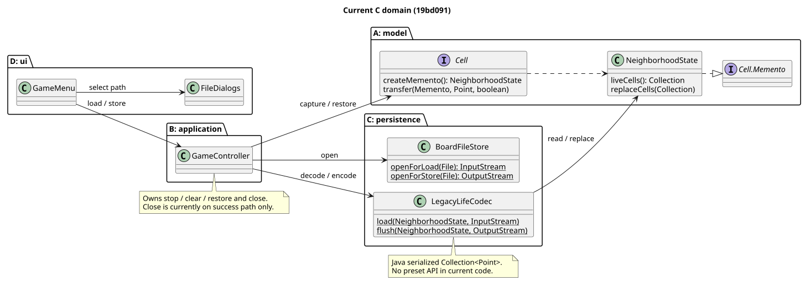
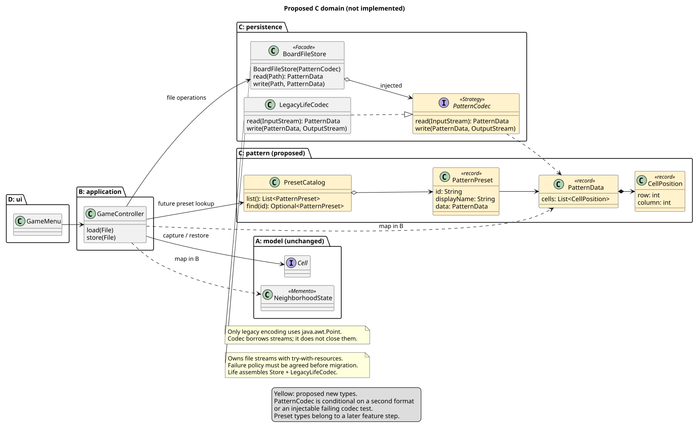

# [002] C 도메인의 공개 계약과 패턴 기반 리팩토링 제안

- 상태: **대체됨(→ [003](003-file-api-and-model-values.md))**. 아래 내용은 2026-11-04 분석·제안 기록이다. #61의 채택 API와 구현 범위는 003을 따른다.
- 작성: Codex / 2026-11-04 / 담당 도메인 C(도현).
- 관련: [#31](https://github.com/DesignPattern8/DPTermProject/issues/31), 최초 추출 #24, CI 정합성 복구 #29. 코드 기준 `19bd091`.
- 질문: 상태를 어떤 형식으로 보관하며, 누가 C를 호출하고, 어떤 계약과 GoF 패턴이 다음 변경을 감당하는가?

## 2026-11-11 PR 제출 시점의 변경 사항

아래 본문과 다이어그램은 `19bd091`(2026-11-04)의 분석·제안 기록이다. 최신 main의 구현과 구분하기 위해 당시 내용을 보존한다. 후속 구현에는 다음 변경을 우선 적용한다.

- [#42](https://github.com/DesignPattern8/DPTermProject/pull/42) 병합으로 B의 load/store는 try-with-resources를 사용한다. 본문의 스트림 누수 관찰은 해결되었고, 읽기 실패 시 기존 보드가 지워지는 동작과 출력 파일 안전 교체는 후속 과제다.
- [#50](https://github.com/DesignPattern8/DPTermProject/pull/50) 병합으로 A의 `Board`, `CellPosition`, 불변 `BoardSnapshot`이 구현되었다. C의 스냅샷 연결은 미구현이다. 아래 C 소유 `CellPosition`·`PatternData`는 당시 제안이며, 구현 전에 기존 모델 타입 재사용과 프리셋 데이터의 별도 필요성을 재검토한다.
- [최신 모델 인계 계약](../../model/docs/interfaces.md#후속-작업-인계)에 따라 `.life`는 `Collection<Point>`와 x=column/y=row 매핑을 유지한다. 크기는 대상 보드에서 받고, 중복은 한 칸으로 처리하며 범위 밖 좌표는 건너뛴다. 파일 출력은 기존 순회 순서를 따른다. 아래 순서·중복 보존 제안과 모델의 집합 스냅샷은 파일 변환 경계에서 구분한다.
- [#30](https://github.com/DesignPattern8/DPTermProject/issues/30)에서 실제 리팩토링·호출부 이전·테스트를 진행한다. 본 PR의 C-01~08은 예정 케이스이며 실행 결과가 아니다.

## 1. 현재 구조와 문제

C는 [LegacyLifeCodec](../LegacyLifeCodec.java) 31줄과 [BoardFileStore](../BoardFileStore.java) 16줄, 합계 47줄이다. 공백·주석 포함 `wc -l` 실측값이며 Java 최상위 클래스 2개, Java interface 0개, 공개 작업 메서드 4개다. 프리셋 구현·카탈로그는 현재 src에 없다. 테스트의 BLINKER/BLOCK/GLIDER 배열은 제품 프리셋 API가 아니다.

현재 공개 메서드와 모든 운영·테스트 호출자는 [interfaces.md](interfaces.md)에 정리했다. 이 문서는 그 계약을 바탕으로 다음 설계를 제안한다.

### 파일 읽기·쓰기 흐름

Load는 D의 `GameMenu.load` → `FileDialogs.userSelected` → B의 `GameController.load` 순서다. B는 C에서 stream을 연 다음 Clock.stop → board.clear → createMemento → C Codec.load → A transfer(LOAD) → stream.close를 실행한다. [GameController.java:43](../../application/GameController.java#L43)에 실제 순서가 있다.

Store는 D의 `GameMenu.store` → 파일 선택 → B의 `GameController.store` 순서다. B는 출력 stream 열기 → stop → A createMemento → C Codec.flush → close를 실행한다. [Neighborhood.java:356](../../model/Neighborhood.java#L356)의 createMemento가 이미 STORE transfer를 하므로 B/C가 같은 Memento에 transfer(STORE)를 다시 수행하면 중복된다.

[현재 구조 원본](diagrams/c-current.puml) / [그림](diagrams/c-current.svg).



### 파일 형식과 기존 파일 호환

현재 `.life`는 JSON·텍스트가 아니라 ObjectOutputStream의 Collection<Point>다. Point.x는 열, Point.y는 행이다. 파일에 명시적 버전, 보드 크기, 게임 규칙, 세대 번호, 프리셋 이름은 없다. 현재 형식을 그대로 “게임 전체 저장”으로 확장했다고 표현하면 안 된다.

Codec은 Collection 및 Point 타입만 검증한다. 중복 좌표를 가진 과거 파일도 읽으며, A의 isAlive 조회에서는 중복이 같은 생존 칸으로 반영된다. 새 보드 저장은 각 좌표를 한 번 기록한다. 호환성의 기본 기준은 **같은 셀 복원**이며 바이트 완전 일치·중복 보존·컬렉션 구현체까지 유지해야 하는지는 변경 전에 별도로 정한다. 초기 리팩토링에서는 순서·중복도 보존하여 불필요한 차이를 피한다.

### 실제로 남아 있는 결합과 실패 경로

| 근거 | 관찰 | 개선이 필요한 이유 |
| --- | --- | --- |
| LegacyLifeCodec:3, 12, 21, 27 | C가 A의 구체 NeighborhoodState를 인자로 받고 변경 | 파일 해석만 시험하려 해도 A 데이터 구조를 알아야 함 |
| NeighborhoodState:10~17 | raw Collection을 노출하고 그대로 교체 | 형식 밖 코드도 잘못된 값·mutable Point를 넣을 수 있음 |
| GameController:44~50 | 읽기 전에 clear, 성공 경로에서만 close | 파일 내용 오류 시 보드 소실, 예외 경로 stream 정리 누락 |
| GameController:54~58 | 출력 파일을 먼저 열고 직접 close | 쓰기 실패 시 기존 파일 보존 안 됨, stream 수명 책임이 B/C에 나뉨 |
| BoardFileStore:9~14 | FileInput/OutputStream 생성만 감쌈 | 이름과 달리 완결된 파일 저장 서비스를 제공하지 않음 |
| LegacyLifeCodec:14~20 | readObject 이후 타입 검사 | 역직렬화 전 타입 제한·자원 상한은 별도 정책이 필요 |
| Life:17, GameController:5~6 | B가 정적 C 구현 두 개에 직접 의존 | 실패하는 Codec 대역을 생성자에서 주입할 수 없음 |

또한 createMemento는 순수 조회라고 단정할 수 없다. Neighborhood.transfer:343~347은 amActive·activeEdges도 갱신한다. B의 변환 함수는 기존 캡처 호출을 한 번만 사용하고, 새 수집 순회로 바꾸지 않아야 한다.

위 실패 경로의 수정은 단순 구조 변경과 분리한다. 이번 문서 작업에서는 코드를 고치지 않는다. 읽기 실패 후 clear 유지 여부, 파일 안전 교체, 역직렬화 제한은 별도 버그/정책 이슈와 테스트로 먼저 확정한다.

## 2. 더 필요한 인터페이스

### 2.1 우선 필요한 것은 완결된 파일 API

B가 stream을 관리하지 않고 `read(path)`의 결과를 받아 A에 적용하고, `write(path, data)`를 호출하도록 만든다. 기존 BoardFileStore를 **Facade**로 확장한다. 별도 FileService·Repository·Manager를 겹쳐 만들 필요는 없다. Java interface가 아니어도 다른 도메인에 제공하는 API다.

Facade가 stream 생성과 try-with-resources 정리를 소유한다. C는 보드를 clear하거나 Clock을 멈추지 않는다. 다만 이 형태는 read가 끝난 뒤에야 B가 돌아오므로 기존의 “open 성공 뒤 clear, 해석 실패해도 빈 보드” 순서를 자연스럽게 바꾼다. 따라서 **안전한 Load 정책 변경을 먼저 별도 합의·검증한 후** 이 API로 전환한다. 동작 보존 PR에서 몰래 순서를 바꾸지 않는다.

### 2.2 파일·프리셋이 공유할 불변 데이터

A의 Memento는 모델 복원 계약으로 유지한다. C의 공개 데이터는 모델 객체 대신 좌표 값 목록으로 한다. 보드 전체 크기·진행 상태는 현재 파일에 없으므로 임의로 복원된 것처럼 추가하지 않는다.

```java
// 이하 모두 제안. production에 아직 없는 타입/메서드다.
// C가 소유하는 pattern 패키지. A/Swing에 의존하지 않는 값 타입.
public record CellPosition(int row, int column) {}
public record PatternData(List<CellPosition> cells) {}
```

PatternData 생성자는 non-null 목록과 원소를 확인하고 `List.copyOf` 등으로 방어 복사한다. record 선언만으로 mutable 목록이 불변이 되는 것은 아니다. row/column은 int이며 초기 단계에서는 순서·중복·음수도 그대로 표현한다. 기존 파일에서 허용하던 좌표를 데이터 생성자에서 새로 거부하지 않는다. 목적 보드 경계와 프리셋 배치 가능 여부는 A/B가 판단한다.

좌표 변환은 B의 작은 변환 함수가 담당한다. `NeighborhoodState` ↔ `PatternData`에서 Point(x=column,y=row)를 변환하고 복사한다. A가 C를 import할 필요는 없고 C도 A를 import하지 않게 된다. 이 변환 함수는 단순 매핑이다. 목표 인터페이스를 구현하는 객체 어댑터가 아니므로 GoF Adapter라고 부르지 않는다.

### 2.3 형식 교체가 생길 때 Strategy

```java
// C persistence: stream의 소유자는 호출자. Codec은 닫지 않는다.
public interface PatternCodec {
    PatternData read(InputStream in) throws IOException;
    void write(PatternData data, OutputStream out) throws IOException;
}

// C persistence: 완결된 파일 I/O, 내부에 final PatternCodec 필드 보유.
public final class BoardFileStore {
    public BoardFileStore(PatternCodec codec);
    public PatternData read(Path path) throws IOException;
    public void write(Path path, PatternData data) throws IOException;
}
// LegacyLifeCodec implements PatternCodec로 전환한다.
```

두 번째 파일 형식 또는 독립적으로 실패를 주입할 Codec 대역이 실제로 필요할 때 PatternCodec을 도입한다. 이 문서의 목표 구조는 실패 대역을 이용한 stream 수명 검증을 포함하므로 Strategy를 사용하지만, 단일 형식의 단순 추출만 한다면 구체 LegacyLifeCodec 주입까지로 멈출 수 있다.

LegacyLifeCodec만 Point/객체 직렬화에 의존하게 한다. 기존 파일 출력은 종전과 같은 Collection<Point> 표현으로 변환하며, PatternData 자체를 Java 직렬화해서 새 형식을 만들지 않는다. Codec은 파일 구조와 원소를 검증하고 PatternData를 완성해 반환한다. 파일/stream 오용의 unchecked 예외까지 무차별적으로 IOException으로 감싸지 않는다.

B는 `GameController(Cell, Clock, BoardFileStore)` 형태로 Facade를 전달받고, 조립 지점 Life가 `new BoardFileStore(new LegacyLifeCodec())`를 만든다. D의 load/store 메뉴 호출 시그니처는 유지할 수 있다. 미래 JSON/RLE 지원이 생기면 선택 정책과 Codec 구현을 별도 추가한다. 지금 지원하지 않는 형식·자동 탐지·Factory까지 만들지 않는다.

### 2.4 프리셋이 들어올 때 추가할 API

```java
// 모두 제안. C pattern 소유, 구체 데이터와 카탈로그부터 시작한다.
public record PatternPreset(String id, String displayName, PatternData data) {}
public final class PresetCatalog {
    public List<PatternPreset> list();
    public Optional<PatternPreset> find(String id);
}
```

C는 stable id, 표시 이름, 상대 좌표 데이터를 제공한다. 목록과 데이터는 불변이며 없는 id는 Optional.empty다. 최초 목록 순서는 선언 순서로 고정하고, 표시 이름과 식별자를 분리한다. 내장 프리셋만 있으면 구체 클래스 하나로 충분하다. 파일·네트워크 등 복수 공급원이 생기기 전에는 Catalog interface나 Abstract Factory를 만들지 않는다.

D는 B를 통해 목록을 받아 선택 화면을 만든다. B는 선택한 id와 원점을 받아 A에 배치를 요청한다. C는 화면 컴포넌트, 배치 원점, 겹침 처리, 규칙·승패를 소유하지 않는다. B의 `listPresets()` / `applyPreset(id, row, column)`은 협의할 호출 방향의 예시이며, 반환형과 실패 결과는 A/B/D와 별도 확정한다. 기존 파일의 절대 좌표와 프리셋의 원점 기준 상대 좌표는 각 사용 계약에서 구별한다.

| 제안 계약 | 제공 | 직접 사용 | 도입 조건 |
| --- | --- | --- | --- |
| BoardFileStore.read/write | C | B | stream 수명·실패 정책 합의 후 우선 |
| PatternData / CellPosition | C pattern | B, C; D는 B의 결과로 전달받음 | 프리셋과 파일 데이터 공통화 시 |
| PatternCodec | C | C BoardFileStore, 조립 지점 Life | 두 번째 형식 또는 Codec 실패 대역 필요 시 |
| PresetCatalog.list/find | C | B | 프리셋 기능 구현 시 |
| A의 캡처·복원 계약 | A | B | 기존 Memento 유지, 새 인터페이스 무조건 추가하지 않음 |

## 3. GoF 23개 패턴 비교

이 표는 모두 구현하겠다는 목록이 아니다. 현재 두 클래스와 실제 확장 지점에 적용했을 때 얻는 것과 비용을 비교한다.

| 분류 | 패턴 | 이 코드에서의 판단 |
| --- | --- | --- |
| 생성 | Factory Method | 형식 선택 분기가 아직 없다. Codec 생성 하나에 Creator 상속계층을 추가하지 않음 |
| 생성 | Abstract Factory | Codec·검증기·메타데이터의 교체 가능한 제품군이 없다. 보류 |
| 생성 | Builder | 좌표 목록과 이름 정도는 생성자로 충분. 다단계 편집 입력이 생길 때 재검토 |
| 생성 | Prototype | 불변 프리셋은 공유 가능하고 배치 시 좌표 계산만 필요. mutable 모델 복제와 혼동하지 않음 |
| 생성 | Singleton | C가 전역 상태를 가질 필요 없음. 생성자 주입·테스트 격리와 충돌하므로 제외 |
| 구조 | Adapter | 외부 parser/legacy 객체가 PatternCodec과 다른 API를 가질 때 유효. 현재 자체 Codec을 직접 고칠 수 있어 추가 wrapper는 보류 |
| 구조 | Bridge | 저장 매체와 파일 형식 두 축이 각각 다수일 때 후보. 로컬 파일 하나에서는 계층 비용이 큼 |
| 구조 | Composite | 패턴 그룹/중첩 카탈로그 요구가 없음. 좌표 목록에 Cell 트리 구조를 반복하지 않음 |
| 구조 | Decorator | 압축·암호화 요구가 생기면 stream/Codec 장식 후보. 지금은 동작·형식 변경이므로 제외 |
| 구조 | Facade | **우선 제안**. open/codec/close를 BoardFileStore의 read/write 두 작업으로 묶음 |
| 구조 | Flyweight | 불변 내장 패턴 공유는 가능하지만 공유 객체 풀이 필요한 규모 근거가 없음 |
| 구조 | Proxy | 원격·지연 로딩·접근 제어 요구가 없음. 단순 파일 호출에 대리 객체를 추가하지 않음 |
| 행위 | Chain of Responsibility | 여러 포맷 탐지기가 없고 검증 순서도 짧음. 검증 두 개를 체인 클래스로 분리하지 않음 |
| 행위 | Command | Undo 가능한 Load/Apply는 B 책임. C Codec을 명령으로 만들지 않음 |
| 행위 | Interpreter | 패턴 DSL 문법이 없음. 새 형식 parser 요구가 정해지기 전에는 제외 |
| 행위 | Iterator | Collection/List의 순회로 충분. custom iterator를 추가할 이유 없음 |
| 행위 | Mediator | C는 UI·Clock 간 조정자가 아님. 실행 조정은 기존 B에 둠 |
| 행위 | Memento | **기존 A 구조 유지**. 캡처·복원과 파일 표현을 분리. 영속 데이터 자체를 Undo 체계로 확대하지 않음 |
| 행위 | Observer | 현재 I/O는 동기식이다. 진행 알림 요구 없이 저장 완료 이벤트 버스를 만들지 않음 |
| 행위 | State | 파일 처리 단계는 호출 한 번의 제어 흐름. 재개 가능한 업로드 같은 수명주기가 없어 제외 |
| 행위 | Strategy | **조건부 제안**. PatternCodec에 read/write 알고리즘을 모으고 Facade에 주입 |
| 행위 | Template Method | open/close 틀을 추상 상속으로 만들 수 있으나 형식마다 파일 열기 책임까지 묶임. Facade+구성과 비교해 기각 |
| 행위 | Visitor | Cell 순회가 이미 createMemento/transfer에 있음. 파일 저장 때문에 Cell 계층 전체에 accept를 추가할 이득 없음 |

## 4. 후보별 오버헤드

기준선은 현재 C 2클래스/47줄이다. 아래 추가 타입 수는 제안 도면의 산술값이고, 변경 파일 수·LOC는 **미구현 추정**이다. docs/테스트/생성 그림은 코드 추정에서 제외한다. 런타임 속도는 측정하지 않았다.

| 항목 | A. 패턴 없이 현재 정적 함수 유지 | B. Facade만 | C. Facade+Strategy+불변 데이터 (권고 목표) |
| --- | --- | --- | --- |
| 타입 | 추가/삭제 0 | 추가/삭제 0, 기존 2클래스 수정 | +3: PatternCodec interface, PatternData/CellPosition record. 삭제 0 |
| 변경 파일·LOC 추정 | 0파일/0줄 | 4파일: 두 C 클래스, GameController, Life. +15~45/-10~25줄 | 7파일: B안 4개+새 타입 3개. +70~140/-15~40줄 |
| 호출 간접성 | B가 file opener와 Codec을 각각 호출 | B→Facade→구체 Codec. Codec까지 +1단계 | B→Facade→Codec 구현. +1단계, 전략의 다형 디스패치 추가 |
| 결합도 | B가 C 구체 타입 2개, C가 A 1개·AWT Point 의존 | B가 C 구체 타입 1개, A 의존 유지 | B의 C 참조 타입은 Store+데이터 2개까지 3개로 늘 수 있으나 Codec 의존 제거. C→A 1→0, AWT는 legacy 구현 안에만 남김 |
| tick당 비용 | C 호출 없음 | C 호출 없음 | C 호출 없음. 파일 작업 시 좌표 n개 변환 O(n), 값 객체 n개·목록 복사 발생 가능 |
| 테스트 용이성 | 메모리 stream 가능, B는 정적 Codec 교체 어려움 | 파일 수명 테스트 가능, 구체 Codec 대역 교체 어려움 | 실패 Codec 주입 가능, C 데이터 검증은 A/Swing 없이 가능 |
| 다음 형식 추가 | 기존 Codec 분기·관련 테스트 변경 | 구체 Codec 분기 변경 | 구현 1개+Life/형식 선택 지점+테스트. B의 read/write는 유지 |
| 프리셋 추가 | 모델 Memento에 묶이거나 별도 변환 필요 | 동일 | PatternData 재사용. 별도 Catalog/Preset 타입 2개 추가 |

B안은 기존 Codec을 인스턴스로 바꾸어 주입하되 전용 interface를 만들지 않는 경우다. C안의 타입 수에는 프리셋 2개를 포함하지 않았다. 프리셋까지 도입하면 추가 총 5개, C 전체 7타입이 된다. 클래스 이름만 패턴으로 바꾸는 작업은 하지 않는다.

## 5. 결정과 근거

**Memento는 A에 유지하고, C에는 Facade를 우선 적용하며 필요가 확인되면 Strategy와 불변 데이터로 확장한다.** 이 문서는 미래 설계 제안으로서 기존 [001](001-domain-extraction.md)의 “추출 당시 새 패턴을 넣지 않는다” 결정을 소급해서 바꾸지 않는다. 실제 구현을 채택하는 시점에 후속 결정 문서를 남긴다.

B안은 가장 적은 타입으로 stream 수명 책임을 모을 수 있다. C안은 사용자가 정의한 프리셋 데이터 책임과 Codec 실패 대역 요구를 만족하는 목표다. A안은 현재 동작 보존에는 적절하지만 파일 작업을 B가 조립하는 문제를 해결하지 않는다. Template Method는 상속 기반의 틀을, Bridge는 두 종류의 교체 축을 더 추가하므로 현재 규모에서는 선택하지 않는다.

[제안 구조 원본](diagrams/c-proposed.puml) / [그림](diagrams/c-proposed.svg). 노란 상자는 미구현 타입이다. 기존 A 클래스 관계는 변경하지 않는다.



## 6. 진행 순서와 검증

1. 현재 계약을 고정한다. 기존 CL-M-01~13, EXT-M01~03, GameControllerTest를 유지하고 아래 추가 케이스를 먼저 정의한다.
2. 실패 시 보드 보존·stream 정리·출력 안전성 정책은 각각 별도 이슈/커밋으로 다룬다. 특히 open/clear/close 순서 변경을 리팩토링에 섞지 않는다. 무조건 모든 파일을 거부하는 역직렬화 필터도 기존 호환 계약을 깨므로 별도 설계가 필요하다.
3. 파일 API의 목표 실패 정책이 확정되면 BoardFileStore Facade로 전환한다. B의 모델/Clock 순서, D의 대화상자 책임을 유지한다.
4. 프리셋 또는 실패 Codec 대역을 구현할 단계에서 PatternData와 PatternCodec을 도입한다. B·Life·ClassicBoard·ClassicMementoTest·NativeUiSmoke의 리플렉션 호출까지 이전한 뒤 구 정적 API를 제거한다. 운영/테스트 모두 이전하기 전에 삭제하지 않는다.
5. PresetCatalog와 PatternPreset을 추가하고 B의 선택·배치, D의 표시를 별도 기능으로 연결한다. glider 등 실제 좌표·기준 원점·배치 정책은 기능 명세와 함께 확정한다.

| ID | 분류 | 목적 | 입력/초기 상태 | 기대 결과 | 예정 테스트 메서드 |
| --- | --- | --- | --- | --- | --- |
| C-01 | 정상 | legacy 형식 왕복 | 좌표 (row=5,col=6) | Point(6,5) 저장, 같은 PatternData 복원 | LegacyLifeCodecTest#roundTripsLegacyCoordinates |
| C-02 | 경계 | 빈·중복 파일 호환 | 빈 Collection, 중복 Point 목록 | 빈 패턴 허용, 초기 변환 단계에서는 순서·중복 보존 | LegacyLifeCodecTest#preservesLegacyEmptyAndDuplicateEntries |
| C-03 | 예외 | 형식 오류 명세 | String/null/null 원소/비Point/깨진 stream | IOException, 외부 모델 변경 없음 | LegacyLifeCodecTest#rejectsMalformedContents |
| C-04 | 경계 | 좌표 정책 분리 | 음수·큰 좌표 legacy 파일 | Codec은 값 보존, A/B의 보드 적용 정책은 별도 테스트 | LegacyLifeCodecTest#leavesPlacementValidationToCaller |
| C-05 | 예외 | stream 소유권 | 성공/실패를 일으키는 stream 및 Codec 대역 | Codec은 close 안 함, Facade가 소유 stream은 성공·실패 모두 close | BoardFileStoreTest#closesOwnedStreamsOnSuccessAndFailure |
| C-06 | 경계 | 불변 데이터 | 생성에 쓴 목록을 나중에 변경 | PatternData 값 불변, 원소도 불변 | PatternDataTest#copiesInputCells |
| C-07 | 정상 | 프리셋 조회 | 내장 id와 목록 조회 | 순서·좌표 안정, 목록 수정 불가 | PresetCatalogTest#returnsStableImmutablePresets |
| C-08 | 예외 | 없는 프리셋 | 등록되지 않은 id | Optional.empty, 보드 변화 없음은 B 테스트에서 검증 | PresetCatalogTest#returnsEmptyForUnknownId |

이 표의 클래스/메서드는 **예정 이름**이며 현재 테스트가 아니다. C-05의 실제 File stream 정리는 종료 경로 테스트와 파일 핸들 검증 방법을 구현 전에 정한다. 이 검증만을 위해 별도 StreamFactory 인터페이스를 무조건 추가하지 않는다.

## 7. 합의가 남은 항목

- A/B: 스냅샷 중 tick과의 경쟁, 실패한 Load의 보드 보존, 좌표 범위·배치 겹침 처리.
- B/C: 파일 읽기/쓰기 실패 정책, 기존 API 제거 시점, 출력 파일 안전 교체 방식.
- C/D: 프리셋 표시명·목록 순서·이름의 지역화, B를 통한 조회 계약.
- C: 기존 파일 fixture 확보와 허용 컬렉션 범위. 현재 테스트는 ObjectOutputStream으로 만든 데이터이며 외부의 모든 과거 파일을 검증했다고 주장할 수 없다.
- 새 저장 포맷·자동 탐지·압축·Undo/Redo·게임 규칙 저장은 이번 문서의 확정 구현 범위가 아니다.

## 문서 검증 기록

2026-11-04에 src/test의 직접 호출과 NativeUiSmoke의 리플렉션 호출을 대조했다. GoF 비교표는 생성 5개·구조 7개·행위 11개, 총 23개다. 현재/제안 PlantUML 두 개를 프로젝트의 renderDiagrams 작업으로 PNG·SVG 렌더링하고 그림을 확인했다. 문서 상대 경로와 `git diff --check`를 검사했다. Java 구현과 테스트 코드는 변경하지 않았으므로 JUnit은 재실행하지 않았다.
