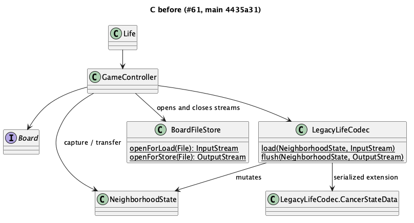
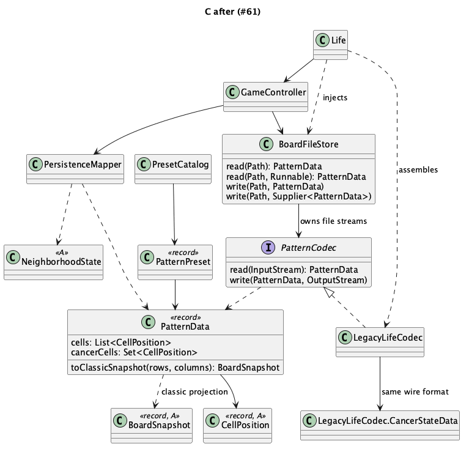

# [003] 모델 좌표를 재사용하는 파일 API와 프리셋

- 상태: 채택
- 작성자: Codex / 2026-11-14 / 관련 이슈: #61
- 기준: origin/main 4435a31. 002의 구현 제안을 이 결정으로 대체한다.

## 문제

`LegacyLifeCodec.java:22`는 `NeighborhoodState`를 직접 변경한다. `GameController.java:113`부터 파일 열기·모델 조작·해석·닫기를 조립한다. #60 이후 파일에는 암세포도 포함되지만 `BoardSnapshot`은 클래식 생사만 표현한다. 스냅샷으로 저장 경로 전체를 교체하면 암세포와 기존 순회 순서를 잃는다.

## 후보

### A. 정적 함수 유지

추가 타입은 없지만 C가 구체 Memento에 의존하고 B는 스트림을 소유한다. 실패 Codec 주입이 어렵다.

### B. Facade + 구체 Codec

파일 수명은 모으지만 실패 대역을 만들려면 구체 클래스 상속이 필요하다.

### C. Facade + Strategy + 불변 데이터 — 채택

`BoardFileStore`가 파일을 열고 닫고 `PatternCodec`이 스트림을 해석한다. `PatternData`는 A의 `CellPosition`을 재사용하고 순서·중복을 보존하는 생존 목록과 암세포 집합을 방어 복사한다. Memento 변환은 B의 `PersistenceMapper`에 둔다. 기존 GoF 23개 비교는 [002](002-public-contract-and-refactoring.md#3-gof-23개-패턴-비교)를 따른다. Memento는 A에 유지한다.

## 결정과 근거

- Codec은 모델을 변경하지 않고 데이터를 반환한다. 전달받은 스트림은 닫지 않는다.
- Facade의 `read(Path, Runnable)`은 파일 개방 성공 후, 해석 전에 콜백을 실행한다. B가 Clock 정지와 Clear를 담당하므로 파일 없음은 보드 유지, 내용 오류는 Clear라는 기존 정책을 보존한다. 기본 `read(Path)`는 콜백 없이 읽는다.
- `write(Path, Supplier<PatternData>)`는 출력 파일 개방 후 캡처한다. 기존 개방→정지→캡처→기록 순서와 개방 실패 시 Clock 유지 계약을 지킨다. 기본 데이터 인자 오버로드도 제공한다.
- Controller의 기존 잠금 안에서 Load 전체와 Store 캡처를 수행한다. C는 Clock/Board/화면에 접근하지 않는다.
- Store는 기존 `createMemento()` 한 번의 순회 결과를 사용한다. Load의 Clear 직후 빈 보드 캡처는 빈 Memento 생성으로 바꾼다. Clear가 활성 상태를 이미 초기화하므로 빈 순회의 추가 효과는 없다. 적용은 기존 transfer(LOAD)를 사용해 암세포와 활성 경계를 유지한다.
- `.life`는 암세포가 없으면 기존 `LinkedList<Point>`, 있으면 기존 중첩 `LegacyLifeCodec$CancerStateData` 이름·필드·serialVersionUID를 보존한다. 다른 클래스 이름의 새 직렬화 포맷을 만들지 않는다.
- `PatternData.toClassicSnapshot(rows, columns)`는 대상 크기로 중복 제거·범위 필터링한다. 암세포가 있으면 명시적으로 거부하여 손실 변환을 막는다. 실제 파일 경로는 암세포 지원과 순회 보존을 위해 Memento를 사용한다.
- 내장 block/blinker/glider의 상대 좌표와 안정된 id를 C 카탈로그로 제공한다. UI 선택과 배치는 B/D 후속 작업이다. 프리셋은 불변이므로 Prototype/Factory 계층을 추가하지 않는다.

## 오버헤드 비교표

구현 전 추정: A +0타입, B +데이터/매핑 2타입, C는 B에 Codec 인터페이스 1개 추가. 프리셋 2타입은 별도 기능이다.

| 항목 | A 정적 유지 | B Facade | C Facade+Strategy |
| --- | --- | --- | --- |
| 간접성 | B→Codec | B→Store→Codec (+1) | B→Store→Codec (+1, 다형 호출) |
| 결합 | C→NeighborhoodState, Point | 데이터 분리 시 구체 모델 의존 제거 | C는 모델 값 CellPosition/BoardSnapshot만 참조, AWT는 Codec에 한정 |
| 런타임 | 기존 순회/직렬화 | 좌표 O(n) 변환 | 동일, tick에는 C 호출 없음; 속도 미측정 |
| 테스트 | 모델 Memento 필요 | 메모리 스트림 가능 | 실패 Codec 주입 및 파일 스트림 종료 직접 검증 |
| 확장 | Codec 분기 | 구체 Codec 수정 | Codec 구현 1개와 조립 지점·테스트 추가 |

### 구현 후 실측

`origin/main`(4435a31) 대비 production Java만 계산했다. 공백·주석 포함이며 테스트·문서·이미지는 제외한다. `git diff --numstat`의 기존 파일과 새 Java 파일 줄 수를 합산했다.

- 변경 9파일: 기존 4파일 + 새 5파일. +240/-53 LOC, 순증 187줄.
- 최상위 타입 +5/-0: C의 PatternCodec(interface), PatternData/PatternPreset(record), PresetCatalog(class), B의 PersistenceMapper(class). 중첩 CancerStateData는 이름과 타입을 유지한다.
- 파일 API·모델 연결만은 7파일, +183/-53 LOC. 프리셋 기능은 2파일/+57 LOC다.
- C의 구체 NeighborhoodState 의존은 1→0. 모델 값 타입 의존은 CellPosition·BoardSnapshot 두 개로 증가한다. Point는 Codec에만 남고 Swing 의존은 없다. B는 기본 생성자 호환을 위해 LegacyLifeCodec 조립 의존을 유지한다.
- 파일 호출은 B→Store→Codec으로 +1 단계. 좌표 n개와 암 좌표 c개의 왕복 변환에 O(n+c) 값 객체/Point 복사와 목록·집합 복사가 추가된다. 실제 시간·객체 수 벤치마크는 수행하지 않았다.
- 다음 프리셋은 PresetCatalog의 선언 1곳과 테스트/문서만 추가한다. 다음 Codec은 구현 1개와 선택/조립 지점 및 테스트를 추가한다.

## 전/후 비교

[변경 전 원본](diagrams/003-before.puml) / [변경 후 원본](diagrams/003-after.puml). 002의 그림은 당시 기록으로 보존한다.

| 변경 전 | 변경 후 |
| --- | --- |
|  |  |

## 후속 작업

완료 범위는 C 파일 API·B 호출 이전·모델 값 변환·프리셋 카탈로그다. 후속 담당 범위: B/D 프리셋 화면·배치·겹침 정책 #62, B/C Load 실패 보드 보존 #63, C/B 출력 파일 안전 교체 #64, C 역직렬화 타입·자원 제한 #65. 각각 별도 이슈·PR로 처리한다. 외부 과거 파일 전체 호환은 주장하지 않으며 이 PR 이전 Codec으로 만든 고정 fixture를 검증한다.
