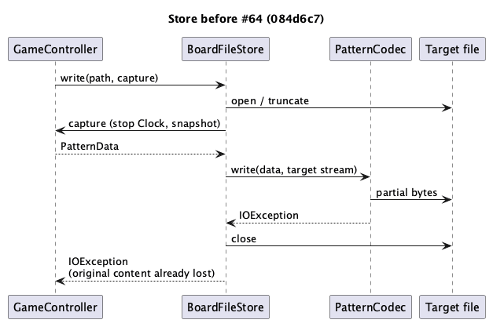
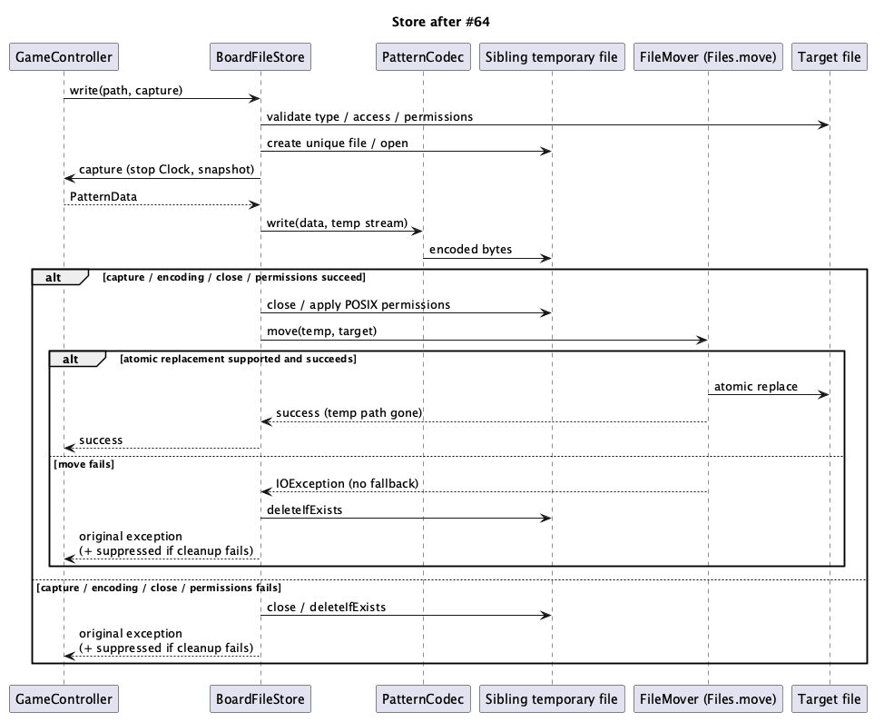

# [004] 실패한 Store에서 기존 파일을 보존하는 원자적 교체

- 상태: 채택
- 작성자 / 날짜: Codex / 2026-11-16
- 관련 이슈: [#64](https://github.com/DesignPattern8/DPTermProject/issues/64)
- 기준: `refactor/base` 084d6c7. 003의 파일 저장 순서 계약만 대체하며 Load/Codec 형식은 유지한다.

## 문제

변경 전 `BoardFileStore.java:35~40`은 대상 파일을 FileOutputStream으로 열어 먼저 truncate한다. capture가 예외를 던지거나 Codec이 일부 바이트를 기록한 뒤 실패하면 원래 파일은 이미 소실된다. 새 경로에도 실패한 빈/부분 파일이 남는다. B의 `GameController.store`는 C가 전달한 capture 안에서 Clock 정지와 Memento 캡처를 하므로 파일 준비 실패는 capture 전에 반환해야 한다.

## 후보

### A. 패턴 없이 대상 파일에 직접 기록

현재 구조와 추가 비용이 없지만 기존 데이터 보존을 만족하지 못한다.

### B. 기존 Facade 안에서 임시 파일 기록 후 원자적 이동 — 채택

BoardFileStore가 임시 파일·stream·이동·실패 정리를 함께 소유한다. Codec과 B의 공개 시그니처는 유지한다. 이동만 package-private 함수 대역으로 교체하여 실패를 결정적으로 시험한다. 별도 공개 저장 전략은 추가하지 않는다.

### C. Command로 저장/복구 객체 구성

대상 파일을 백업하고 rollback하는 명령을 둘 수 있지만 백업·복구도 실패할 수 있고 상태/파일이 추가된다. Undo 요구가 없는 단일 파일 저장에는 부적합하다. Template Method 상속도 Codec Strategy와 파일 수명을 중복 분리하므로 채택하지 않는다.

## 결정과 근거

1. 대상의 부모 경로를 실제 경로로 해석한다. 최종 대상은 일반 파일 또는 없는 경로만 허용한다. 디렉터리·심볼릭 링크(깨진 링크 포함)·특수 파일은 IOException으로 capture 전에 거부한다. 부모 디렉터리는 자동 생성하지 않는다.
2. 기존 파일이 쓰기 불가능하면 capture 전에 거부한다. POSIX 환경의 기존 rwx 권한은 교체 파일에 복사한다. 새 파일은 createTempFile의 제한적인 기본 권한을 유지한다. 소유자·ACL·확장 속성·하드 링크 관계까지 보존하는 API는 아니다.
3. 대상과 같은 폴더에 고유 임시 파일을 생성하고 연 뒤 capture를 한 번 호출한다. Codec 기록과 stream close가 성공하기 전까지 원래 대상은 건드리지 않는다.
4. 완성한 임시 파일의 권한을 적용한 후 Files.move(ATOMIC_MOVE, REPLACE_EXISTING)로 교체한다. 원자적 교체 또는 기존 파일 교체를 제공하지 않는 provider에서는 예외를 반환한다. 대상 삭제·비원자적 move/copy로 재시도하지 않는다.
5. capture/기록/close/권한 적용/이동 실패 시 임시 파일 삭제를 시도하고 원래 예외를 유지한다. 삭제 자체가 실패하면 그 예외(잔여 경로 포함)를 suppressed로 붙인다. 성공한 이동 뒤에는 임시 파일 경로가 남지 않는다.
6. C가 파일 준비를 마친 뒤 B의 capture가 호출되므로 Clock 정지 시점은 유지한다. 기록/교체 실패 후 Clock은 정지 상태이며 Store는 화면 변경 알림을 보내지 않는다. Load의 실패 정책(#63)은 변경하지 않는다.

[Java Files.move 계약](https://docs.oracle.com/en/java/javase/26/docs/api/java.base/java/nio/file/Files.html#move(java.nio.file.Path,java.nio.file.Path,java.nio.file.CopyOption...))상 ATOMIC_MOVE에서는 다른 옵션이 무시되고 기존 대상 교체 가능 여부는 provider에 달려 있다. 비원자적 이동은 실패 시 파일 상태가 불확실할 수 있어 fallback으로 사용하지 않는다.

## 오버헤드 비교표

| 항목 | A 직접 기록 | B Facade + 임시 교체 | C Command + rollback |
| --- | --- | --- | --- |
| 구조 비용 | 추가 0 | 기존 클래스 1개 변경, 중첩 interface +1; +70/-4 LOC 실측 | 명령/백업 상태 추가, 미구현 |
| 간접성 | Store→Codec | Codec 경로 동일, 완료 후 이동 함수 1회 | 명령 execute/rollback 호출 추가 |
| 결합도 | java.io | java.nio.file/attribute 추가, A/Swing 의존 추가 없음 | 백업/복구 정책과 결합 |
| 런타임 | 대상에 n바이트 기록 | n바이트 기록 + 파일 이동 + 속성 조회, 최대 n바이트 추가 디스크 공간 | 원본 백업과 복구 I/O 추가 가능 |
| 테스트 | 실제 손상 재현 가능 | 실패 Codec·이동 대역으로 실제 파일 보존 검증 | rollback 실패 조합 증가 |
| 확장 비용 | 실패 안전성 없음 | 다른 Codec도 같은 Store API 사용 | 저장 명령과 복구 정책 함께 수정 |

production Java는 BoardFileStore 1파일만 변경했다. `git diff --numstat 084d6c7 -- src/.../BoardFileStore.java` 기준 +70/-4 LOC(순증 66), 최상위 타입 +0, package-private 중첩 FileMover interface +1이다. 공백·주석 포함이며 테스트/문서/이미지는 제외한다. B/A/D production 변경은 없다. API를 쓰는 도메인의 참조 타입 수는 그대로이며 C 내부에서 java.nio.file.attribute 패키지 의존이 추가된다. 실제 시간/객체 수는 벤치마크하지 않았다.

## 전/후 비교

[이전 원본](diagrams/004-before.puml) / [이후 원본](diagrams/004-after.puml). 003의 다이어그램은 당시 기록으로 보존한다.

| 변경 전 | 변경 후 |
| --- | --- |
|  |  |

## 후속 작업과 범위

전원 중단 시 디스크 내구성(fsync), 강제 프로세스 종료 후 임시 파일 청소, 외부 프로세스와의 동시 파일 교체/권한 변경, owner/ACL/확장 속성 보존은 이번 계약에 포함하지 않는다. 동일 파일의 동시 저장은 마지막 성공한 교체 결과를 남긴다. 읽기 보존 #63, 프리셋 연동 #62, 역직렬화 제한 #65는 독립 작업이다.

검증 결과와 재현 방법은 [#64 검증 기록](verification-064.md)을 따른다.
