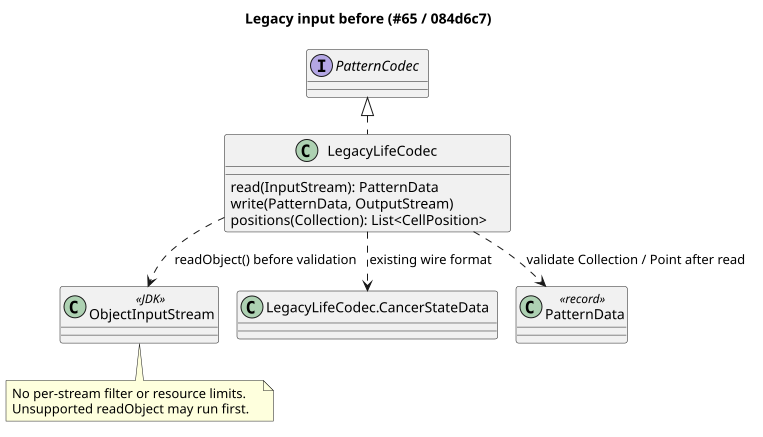
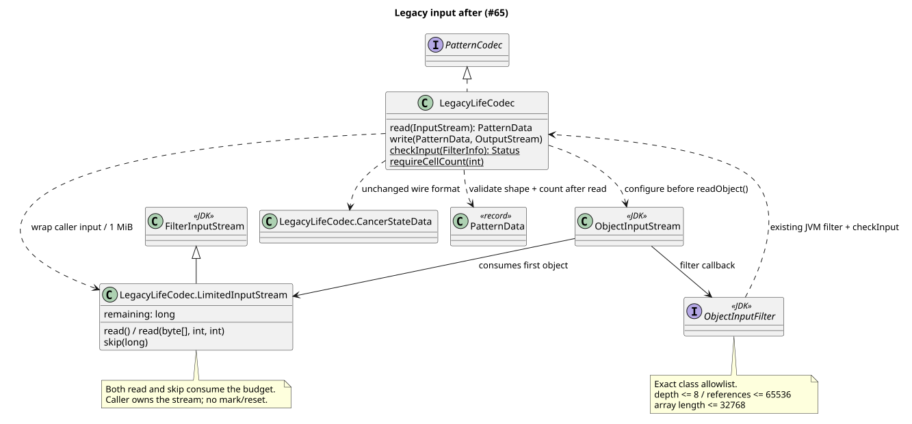

# [005] Legacy 역직렬화 허용 타입과 자원 한도

- 상태: 채택
- 작성자 / 날짜: Codex / 2026-11-16
- 관련: #65 / 기준: refactor/base 084d6c7
- 004는 별도 #64·PR #79의 저장 교체 결정 번호로 예약한다. 이 PR은 #64를 포함하지 않는다.

## 문제

기준 코드 `LegacyLifeCodec.java:17`은 readObject를 끝낸 뒤 Collection/Point 여부를 검사한다. 지원하지 않는 클래스의 readObject도 검증 전에 실행될 수 있다. 파일 크기·배열·그래프 한도는 없다. 허용 범위 축소는 명시적인 정책 변경이며 파일 형식 자체는 바꾸지 않는다.

## 후보

### A. 패턴 추가 없이 Codec 경계에 JDK 필터 + 입력 바이트 한도 — 채택

ObjectInputStream을 만든 직후 readObject 전에 정확한 클래스 허용 목록과 그래프 한도를 설치한다. 기존 JVM 필터가 있으면 merge하여 제한을 완화하지 않는다. 바이트 한도 stream은 필터가 검사하지 않는 문자열·primitive block data도 제한한다. Codec 밖의 공개 API는 늘리지 않는다.

### B. Decorator로 모든 PatternCodec 입력 제한

형식마다 허용 클래스가 다르며 현재 객체 직렬화는 LegacyLifeCodec 하나뿐이다. 별도 Codec 장식 타입과 조립 변경을 추가할 근거가 없다. stream 바이트 제한은 작은 내부 FilterInputStream으로만 구현한다.

### C. Proxy 또는 사용자 ObjectInputStream으로 객체 복원 전체 대체

표준 필터보다 많은 Java 직렬화 내부 계약을 직접 관리하게 된다. 외부 parser 교체 요구도 없어 선택하지 않는다.

## 호환 근거와 허용 범위

- 저장소와 전체 Git 이력에 커밋된 .life 파일은 발견하지 못했다. 외부 사용자의 모든 과거 파일을 확보했다고 주장하지 않는다.
- 초기 코드 e38ce7a의 실제 `Neighborhood$NeighborhoodState.markAsAlive/flush`를 별도 클래스 경로에서 실행하여 고정 파일을 생성했다. 입력 Point는 (6,5), (-1,1000), (6,5)이고 좌표 순서·중복·음수를 포함한다. SHA-256: `0726876c6308d7293fcd162b8bbb1f8881124252d8f374dbbb2367b26beaa7b7`. 테스트에 Base64로 고정한다.
- #60/4435a31의 기존 정상·잘못된 암세포 fixture와 기존 CL-M/CAN-P 테스트를 유지한다.
- 외부 Collection은 LinkedList, ArrayList, HashSet, Arrays.asList의 Arrays$ArrayList, List.of의 List12/ListN, Collections.emptyList/singletonList를 지원한다. 임의 Collection/Point 하위 클래스, Vector, 사용자 정의 클래스, 프록시는 허용하지 않는다.
- 값 타입은 **정확한 java.awt.Point**, 암세포 envelope는 기존 **LegacyLifeCodec$CancerStateData**만 허용한다. 클래스 이름 접두사나 isAssignableFrom으로 하위 클래스를 포괄 허용하지 않는다.
- JDK 내부 직렬화 보조 타입 CollSer, Object[], Point[], HashSet 용 Map.Entry[]를 허용한다. 이것이 최상위 배열이나 잘못된 원소를 유효 파일로 인정한다는 뜻은 아니다. 복원 후 기존 Collection/Point 의미 검사를 계속 수행한다. JDK 비공개 List 타입 이름은 java.base 모듈의 정확한 이름만 인정한다.

## 한도와 근거

| 한도 | 값 | 적용 |
| --- | --- | --- |
| 소비하는 입력 바이트 | 1,048,576 (1 MiB) | stream read/skip 양쪽에 강제, caller stream 비소유 |
| 객체 그래프 깊이 | 8 | ObjectInputFilter |
| 누적 참조 수 | 65,536 | ObjectInputFilter, 반복 객체 참조 포함 |
| 개별 배열 길이 | 32,768 | 할당 전 ObjectInputFilter |
| 생존/암세포 컬렉션 원소 수 | 각각 16,384 | 읽기 의미 검사 및 쓰기 전 검사 |

현행 64×64 보드 4,096칸의 네 배까지 각 좌표 목록에 허용한다. 중복도 원소 수에 포함한다. 상한은 성능 벤치마크 결과가 아니라 제한된 파일 형식의 정책값이다. JDK 26에서 현행 writer로 모든 좌표를 암세포로 만든 파일을 실측했다.

| 좌표 수(생존=암) | 파일 바이트 | 최대 깊이 | 최대 filter 참조 | 최대 내부 배열 |
| --- | --- | --- | --- | --- |
| 4,096 | 114,962 | 3 | 8,199 | 8,192 |
| 16,384 | 459,026 | 3 | 32,775 | 32,768 |

유효한 최대 출력이 한도 안에서 다시 읽히도록 write도 원소 수를 ObjectOutputStream 생성 전에 검사한다. 초과하면 IOException이고 caller 출력 stream에는 쓰지 않는다. BoardFileStore의 기존 직접 truncate 동작은 #64에서 별도로 수정한다.

## 계약과 제한

- 금지 타입/그래프 초과는 InvalidClassException(IOException 하위), 바이트/원소 한도·의미 오류는 IOException으로 전파한다. 보드 적용/Clock 정책은 B 책임이며 #63의 실패 보존 정책을 변경하지 않는다.
- read는 첫 객체만 해석하는 기존 계약을 유지한다. 한도는 전체 파일 길이가 아니라 **첫 객체 해석에 소비한 바이트**다. 뒤에 붙은 데이터 전체를 스캔하거나 역직렬화하지 않는다.
- 필터는 String/primitive 값을 직접 검사하지 않으므로 바이트 제한이 별도로 필요하다. 기존 전역 필터와 합치지만 전역 설정 자체를 수정하지 않는다. 애플리케이션이 설치한 사용자 필터 factory는 JVM 신뢰 설정이다.
- 이 정책은 허용 타입과 입력/구조 크기를 제한한다. JDK 타입의 모든 메서드에 대한 CPU 시간·힙 사용량 상한, 모든 악의적인 그래프에 대한 sandbox를 보장하지 않는다.
- 정상/실패 모두 caller stream을 닫지 않는다. 내부 한도 wrapper의 mark/reset은 지원하지 않고 skip도 같은 예산에서 차감한다.

근거: [JDK ObjectInputFilter](https://docs.oracle.com/en/java/javase/26/docs/api/java.base/java/io/ObjectInputFilter.html), [ObjectInputStream 필터 설치 계약](https://docs.oracle.com/en/java/javase/26/docs/api/java.base/java/io/ObjectInputStream.html#setObjectInputFilter(java.io.ObjectInputFilter)).

## 오버헤드 비교표

| 항목 | A Codec 내부 정책 | B Codec Decorator | C 복원 Proxy |
| --- | --- | --- | --- |
| 구조 | Codec 1파일 +115/-2 LOC, 최상위 타입 +0, 내부 stream 타입 +1 | 미구현 추정: 최상위 wrapper +1, 최소 3파일(Codec/장식/조립), LOC 미측정 | 미구현 추정: 최상위 stream +1, 최소 2파일, LOC 미측정 |
| 간접성 | 필터 callback 및 stream read/skip 위임 +1 | Codec 호출 +1에 내부 필터도 필요 | 복원 단계마다 자체 hook |
| 결합도 | 소스 의존 패키지 5→5; A/Swing 변화 0 | 모든 Codec과 결합 | Java 직렬화 내부 구조에 강하게 결합 |
| 런타임 | read당 wrapper +1, filter callback·read/skip 계수 검사; 시간/힙 미측정 | 같은 검사 + 장식 호출 | 미구현 |
| 테스트 | in-memory 파일·고정 fixture·무해한 readObject 표식 | 장식·실제 Codec 조합 필요 | 사용자 복원 경로까지 검증 |
| 확장 비용 | 형식에 허용 타입 추가 시 1곳과 호환/거부 테스트 | 장식 설정 및 조립도 수정 | 클래스 해석 규칙 추가 |

생산 코드 LOC는 `git diff --numstat 084d6c7 -- src/com/holub/life/persistence/LegacyLifeCodec.java` 기준(공백 포함). 소스 의존 패키지는 java.lang/java.io/java.util/java.awt/com.holub.life.model 다섯 개로 유지한다. ObjectInputFilter와 내부 FilterInfo/Status, FilterInputStream, Map.Entry, Objects, Class를 추가 참조한다. ArrayList는 기존에도 완전 수식명으로 사용했다. 외부 API나 A 모델 의존성은 늘지 않는다. 전체 변경 파일과 테스트 실측은 [검증 결과](verification-065.md)를 참조한다.

## 결정과 근거

A는 단일 Legacy 직렬화 경계에서 JDK 필터와 작은 stream Decorator만 사용한다. B의 별도 Codec Decorator나 C의 복원 Proxy는 현재 한 형식에 추가 조립·직렬화 구현 책임을 늘리므로 기각한다. 정상 과거 출력은 유지하고, 폭넓던 Collection 허용은 검증된 구현체로 명시적으로 축소한다.

## 전/후 비교

[이전 원본](diagrams/005-before.puml) / [이후 원본](diagrams/005-after.puml). 003은 당시 분석 기록으로 유지한다.

| 이전 | 이후 |
| --- | --- |
|  |  |

## 후속 작업

외부 과거 파일이 확보되면 fixture로 추가하고 허용 목록 확장은 별도 결정으로 남긴다. 다른 JDK로 변경하면 CollSer/List 내부 타입 호환 테스트를 재실행한다. #62 프리셋 UI, #63 Load 실패 보존, #64 안전한 Store는 별도 작업이다.
