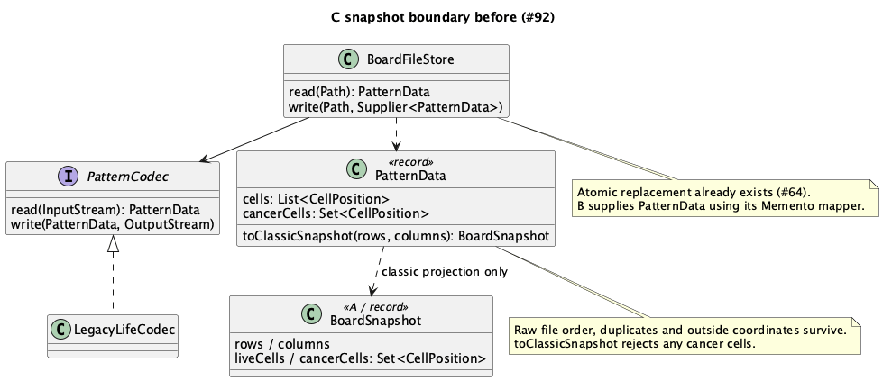
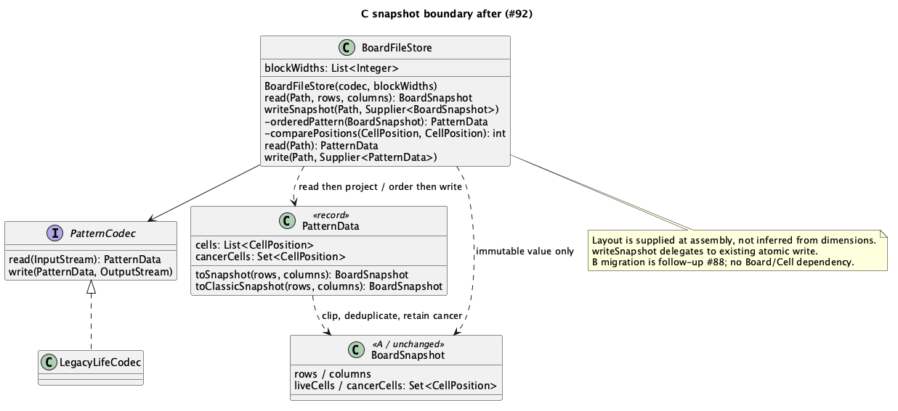

# [006] 스냅샷 파일 경계와 블록 출력 순서

- 상태: 채택 — C API 구현. B Controller 이전은 #88 후속 작업.
- 작성자: 도현 / Codex, 2026-11-18
- 관련: [#92](https://github.com/DesignPattern8/DPTermProject/issues/92), [B 사전 공유 계약](https://github.com/DesignPattern8/DPTermProject/issues/88#issuecomment-6953096811)
- 기준: `refactor/base` `c2d09a9`. 003의 Memento 유지 이유 중 암세포 표현 한계는 A #73에서 해결됐다. 기존 호출부는 이 PR에서 바꾸지 않는다.

## 문제

`PatternData.toClassicSnapshot()`은 암 정보가 있으면 거부한다(`PatternData.java:17`). B가 #88에서 파일용 Cell을 제거하려면 일반·암세포를 함께 변환하는 C API가 필요하다. 파일 좌표에는 중복·범위 밖 값이 있지만 모델 스냅샷은 유효한 좌표 집합만 받는다.

기존 저장은 `Neighborhood.createMemento()`의 블록별 재귀 순회 순서다. A의 `BoardSnapshot.liveCells()`는 순서가 없는 집합이므로 행·열 정렬만으로 기존 순서를 복원할 수 없다. 같은 8×8 크기라도 평면 트리와 4×4 하위 블록 트리의 순서는 다르다. 순서 보존을 위해 모델 내부를 다시 순회하면 B의 Cell 의존 제거와 충돌한다.

## 후보

### A. 패턴 없이 B의 PersistenceMapper에 변환 추가

추가 production 타입은 없지만 B가 파일 호환 좌표 정책과 블록 순서를 알아야 한다. C의 클래식 변환과 필터링이 중복될 수 있고 새 파일 경로도 B를 거쳐야 한다.

### B. 기존 Facade + Strategy + Memento 사용, C에 값 변환 추가 — 채택

`BoardFileStore`가 파일 수명과 모델 값 변환을 조립하고 `PatternCodec`은 기존 wire format을 담당한다. `PatternData.toSnapshot()`은 순수 변환이다. `BoardSnapshot`은 기존 불변 Memento를 사용한다. 파일 기록 순서는 조립 지점이 전달한 불변 블록 폭 목록으로 복원한다. 별도 변환 클래스나 전략 인터페이스는 추가하지 않는다.

### C. Memento 확장: A가 출력 순서를 스냅샷에 포함

순서의 출처는 정확하지만 파일 호환 요구 때문에 A의 공개 데이터·생성자·모든 소비자를 수정해야 한다. 이번 C API 작업에서 A를 변경하지 않고, 현재 균일한 블록 트리는 폭 목록만으로 순서를 표현할 수 있어 기각한다.

### D. Strategy/Adapter를 추가해 저장 순서 주입

임의 Comparator 또는 별도 순서 인터페이스를 받으면 새 정렬을 교체하기 쉽다. 현재는 기존 블록 순서 하나만 필요하고 임의 비교기를 받아도 실제 보드 구조와 일치하는지 보장할 수 없다. 불변 값 목록으로 충분하므로 추가 인터페이스와 구현체를 만들지 않는다. 기존 GoF 23개 검토는 [002](002-public-contract-and-refactoring.md#3-gof-23개-패턴-비교)에 남아 있으며 이번에는 실제 변경 경계와 관련된 Facade·Strategy·Memento·Adapter를 다시 비교했다.

## 오버헤드 비교표

미구현 후보의 비용은 추정이며 실측 LOC를 붙이지 않는다. B열은 이번 구현을 기준으로 한다.

| 항목 | A: B 변환 (추정) | B: C Facade 확장 (구현) | C: A Memento 확장 (추정) | D: 순서 Strategy (추정) |
| --- | --- | --- | --- | --- |
| 구조 | 새 타입 0, B Mapper·Controller와 C 변환 중복 가능 | production 2파일, +99/-10줄(순증 89), 새 production 타입 0 | 최소 Snapshot·캡처·소비자 변경, 필드/계약 추가 | 인터페이스·구현체 최소 2타입 추가 |
| 간접성 | B → Mapper → snapshot 생성 | read → 기존 read → toSnapshot, writeSnapshot → 기존 write의 Supplier → orderedPattern. 각각 기존 경로를 감싸는 API 단계 1개 추가 | C → A 순서 조회 추가 | 비교기 다형 호출 추가 |
| 결합 | B가 파일 좌표·출력 규칙 소유 | BoardFileStore의 모델 값 의존 0→2(BoardSnapshot·CellPosition), PatternData는 기존 2개 유지. C의 Board/Cell/Neighborhood 의존 추가 0 | A 값 계약에 파일 순서 결합 | Store가 새 정책 인터페이스에 의존 |
| 런타임 | 필터·정렬 필요 | 읽기 O(n+c), 쓰기 O(n log n × d+c), 임시 목록/집합 O(n+c). tick 비용 없음. 시간/할당 수 미측정 | 순서 목록을 캡처마다 저장할 수 있음 | 비교 비용은 동일, 정책 객체 추가 |
| 테스트 | B와 C 양쪽 정책 검증 | Swing 없이 실제 파일·기존 Memento 순서와 비교, Codec 대역 재사용 | A 캡처와 C 변환 테스트 필요 | 비교기 대역 가능 |
| 확장 | 정책 변경 시 B·C 조율 | 균일 블록 단계 추가는 조립 폭 목록 1곳 + 테스트. 새 파일 형식은 기존 Codec 확장 | Snapshot 변경 시 소비자 갱신 | 새 정책마다 구현체 추가 |

LOC는 `git diff --numstat c2d09a9 -- src/com/holub/life/persistence/{BoardFileStore,PatternData}.java`와 같은 두 파일 범위로 계산했다(실행 위치에 따라 경로에 `Codes/GameOfLife/` 접두사 추가). 테스트·문서·그림은 제외하고 공백·주석을 포함했다. `n`은 생존 좌표 수, `c`는 암 좌표 수, `d`는 블록 단계 수다. 테스트 production 모델의 AWT 의존은 기존 그대로이며 새 C API는 AWT/Swing 타입을 받지 않는다.

## 결정과 근거

### 읽기

`read(Path, rows, columns)`는 크기를 먼저 검증하고 기존 `read(Path)`로 해석·입력 종료를 완료한 뒤 변환한다(`BoardFileStore.java:71`). 두 좌표 집합을 같은 범위로 필터링하고 생존 중복을 제거한다. 암 좌표를 무조건 생존 집합에 합치거나 버리지 않는다. 필터링 후에도 암 집합이 생존 집합에 포함되지 않으면 모델 생성자가 거부한다. 순수 변환은 IllegalArgumentException, 파일 API는 원인을 보존한 IOException이다. Codec 실행은 변환 catch 밖에 두어 Codec의 런타임 오류를 파일 내용 오류로 오인하지 않는다.

이는 새 스냅샷 API의 표현 한계다. 기존 raw/legacy 경로는 살아 있지 않지만 암 플래그가 있는 비정상 상태를 받아들일 수 있으나 새 모델은 이를 표현하지 않는다. 새 API에서 명시적으로 거부하며 기존 Codec/원시 API의 정책은 바꾸지 않는다. C는 보드·Clock을 변경하지 않아 B가 read 성공 뒤 restore하도록 연결할 수 있다.

### 저장 순서

조립 시 `BoardFileStore(codec, List.of(8, 1))`처럼 루트 자식 블록 폭부터 셀 폭까지 전달한다. 목록은 비어 있지 않고 마지막 값이 1이며 양수·엄격한 내림차순·직전 폭의 약수여야 한다. 스냅샷 행/열도 첫 폭의 배수여야 한다. 중간 폭이 모두 약수이므로 첫 폭 검사로 전체 타일링이 확인된다. 폭 1인 중복 단계는 순서에 영향이 없으므로 제거한 형태로 전달한다.

비교는 단계마다 `row / width`, `column / width` 순이다(`BoardFileStore.java:118`). 앞 단계가 같을 때만 다음 단계로 내려가므로 전역 몫을 비교해도 블록 내부 좌표를 비교한 것과 같다. `[8,1]`은 `(row/8, column/8, row%8, column%8)`과 같은 순서를 낸다. `[6,2,1]`처럼 8이 아닌 다단계 구조도 지원한다. 서로 다른 좌표는 마지막 width=1 단계에서 구분된다.

정렬한 생존 목록과 기존 암 집합을 PatternData로 묶는다. 암 집합 자체의 직렬화 반복 순서나 전체 파일의 byte 동일성은 새로 보장하지 않는다. 기존 wire format과 생존 목록의 순서가 계약이다. 폭 목록은 실제 보드와 일치해야 하고 C가 이를 스냅샷만으로 증명할 수는 없다.

### 저장 수명

`writeSnapshot`은 기존 `write(Path, Supplier<PatternData>)`에 변환 Supplier를 전달한다(`BoardFileStore.java:98`). 대상 검사·임시 파일 개방 후 capture를 한 번 호출하며 정렬도 그 이후다. 정렬·캡처·인코딩 실패는 기존 정리 경로를 타므로 원본 파일을 보존한다. 기존 1인자 Store는 raw API와 새 read에 쓸 수 있지만 순서 설정이 없는 snapshot write는 거부한다. Java 타입 소거 충돌 때문에 Supplier 스냅샷 오버로드 이름은 `writeSnapshot`이다.

## 전/후 비교

| 변경 전 | 변경 후 |
| --- | --- |
|  |  |

[전 원본](diagrams/006-before.puml) / [후 원본](diagrams/006-after.puml). 그림은 C의 제공 API 변화이며 B Controller가 이미 이전됐다는 뜻은 아니다.

## 후속 작업

- B #88: 새 API 연결, 설정된 Store 주입, 파일용 Cell 및 PersistenceMapper 사용처 제거, SNAP-01~08 검증. Life 조립 변경은 D와 조율한다.
- 실제 앱은 이번 PR 뒤에도 기존 Memento 경로를 사용한다. Controller의 순서·좌표·Load 실패 특성 테스트는 그대로 유지한다.
- 불규칙 블록 트리·2인용 소유자 저장은 이번 계약 밖이다. 새 요구가 생기면 별도 계약으로 다룬다.
- 검증 결과와 실행 환경은 [verification-092](verification-092.md)에 기록한다.
